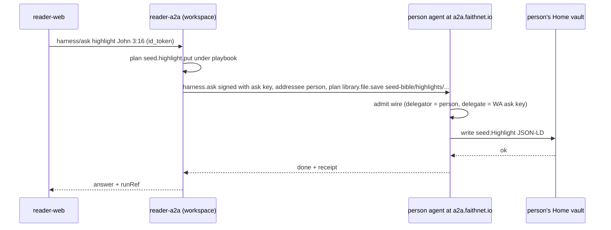

# Person agent, org agent, and skills

The estate already has a person agent for every resident and an org agent for every organization. Seed Bible does not mint a parallel user. The reader **asks those agents**, through skills, under grants signed at **www.faithnet.me**.

## Residents we use

Every resident is a Smart Agent on faithchain. The suffix is the derived type; the on-chain `atl:agentType` is the authority (spec 346, ADR-0061). `.workspace` (4 SHQ base), `.svc` (10), `.church` (6), `.circle` (4) are priced roots; chartering deploys the agent but does not buy the name (`agent-naming/src/price.ts`; `charter-service.mts`).

| Kind                  | Suffix                     | Upper class (`at:`)                                                   | Who it is in Seed Bible                                                                                       |
| --------------------- | -------------------------- | --------------------------------------------------------------------- | ------------------------------------------------------------------------------------------------------------- |
| Person                | `.me`                      | `at:Person`                                                           | The reader. `seedreader.me` is the demo person                                                                |
| Organization          | `.org` `.church` `.circle` | `at:Organization` (`at:ChurchAgent`, `at:CircleAgent` are subclasses) | A ministry, a church that owns a customization, a friends circle; **`seed-reader.org`** governs the workspace |
| Workspace coordinator | `.workspace`               | `at:WorkspaceAgent` (service class)                                   | `seed-reader.workspace` — reader-a2a / reader-mcp                                                             |
| Service               | `.svc`                     | `at:ServiceAgent`                                                     | `seed-bible.svc` — serving plane                                                                              |

**A `.workspace` is a service governed by an org, never by a person.** The Home `workspace-create` ceremony (`ap-home onboarding.ts createGovernedWorkspace`) charters `seed-reader.org` and then `seed-reader.workspace` under it, binds the vault, provisions the interactions grant, and writes the `workspace:<ws>` / `workspace.governor` pair. `service.create` yields a `.svc`, not a `.workspace`. `seedreader.me` stewards both. A workspace has no members (spec 346).

A church customization is not a row in CasualOS. It is an **org agent** that publishes `seed:Customization` works. A `.circle` is an org agent whose membership _is_ the friend group.

## Control is skills, not a records API

CasualOS was "call `recordData` from the browser." Here:

1. reader-web sends an ask (or a plain app route) to **reader-a2a** with the Home id_token.
2. The workspace harness **plans** one or more **skills** under its assigned playbook.
3. A step that touches the person's records is **asked of the person's agent** at `a2a.faithnet.io` with a supplied plan; a step that touches an org's records is asked of the org agent. The person's or org's agent performs the write under its own grant.
4. Domain tools that need no principal (resolve a passage, query the Seed registry, open a session) run on **reader-mcp** (workspace) or **seed-bible-mcp** (serving plane).
5. The run is recorded. The vault artifact is a `seed:` JSON-LD document.

The browser never calls MCP (ADR-0044).

### How "as the person" actually works

`wireAdmission` on a service-host only admits wires whose **delegator is the host agent itself**, so reader-a2a cannot be handed the person's wire and write as them. The working pattern is the one `demo-openbook-reader` uses:

1. The Connect client `seed-bible-reader` is registered with `allowed_delegation_templates: ['site-login', 'ask-as-me']`, its own `delegate` key, `ask_delegate: <reader-a2a asking key>`, `ask_with_login: true`, and `libraryFolders: ['seed-bible']`.
2. On sign-in reader-web obtains the person's **ask-as-me wire** (person → reader-a2a ask key, skill `harness.ask`, 30 days). `exchangeCode` in `connect-client` drops `askDelegation`, so call `/token` directly or run a second `authorize({ delegation_template: 'ask-as-me' })`. Quick Connect: `POST /connect/demo-signin { handle, client_id, delegation_template: 'ask-as-me' }`.
3. reader-web hands the wire to reader-a2a (`/api/connect`), which validates `checkSessionWireShape(wire, { skill: 'harness.ask' })` and stores it per person.
4. To record a mark, reader-a2a signs `harness.ask` with its ask key (`wrapSessionSignature`) and posts to `https://a2a.faithnet.io/harness/ask` with `addressee: <person>` and a **supplied plan**: `library.file.save { folder: 'seed-bible/highlights', name: 'highlight-<id>.json', kind: 'json-ld', text, accessPolicy: 'private' }`. `library.file.save` is `selfAuthorized`; the wire is the authority. The person's agent writes its own vault.

There is no generic typed `vault.records.put` reachable this way. Records are **Library artifacts** (JSON-LD under `seed-bible/<collection>/`), listed and read with `library.file.list/read`. If typed record effects are wanted later, that is `withDomainRecordEffects` plus two ap-home allowlists (`EFFECT_WRITABLE_RECORDS`, `APP_DOMAIN_RECORD_SCOPES`, family `seed-bible.*`).

An org publish is the same shape with the **steward's Home session** at the org: `POST /harness/ask { session, addressee: <org SA>, plan }`; the stewardship wire from `relationships.data` is auto-presented. Public works are `library.file.save` with `accessPolicy: 'public'` + `library.file.publish`; the org's public shelf serves them (`library.public.list/read`), and the `seed-bible.svc` Seed registry indexes them. The town graph gets only the markdown passage. Listing is a fact, not a grant.

### Authority gating on reader-a2a

`authority_required` is produced only for tools that declare a `capability` with `ports.mandateVerifier` (`delegationMandateVerifier`) set and `onMissingMandate: 'report'`; informational tools run ungated. Today `reader-a2a/src/host.ts` has `playbook: () => null`, no ports, and `HELLO_TOOL` without `capability`, so nothing is gated. Production wiring: capability on every act tool, the mandate port, and a resume path `POST /harness/ask { session, runRef, presented: [mandate] }` after the person signs at `${HOME}/you?run=<runRef>`.

## Skills live in `~/skills` (domain `seed`)

The corpus is `~/skills`: one folder per skill, canonical id `skill:<namespace>/<name>`, SHA-256 commitment, append-only log, skill-web at skills.faithnet.io. Domain id is **`seed`** (matches the `seed:` prefix). The domain's spec collection already exists at `~/skills/specs/seed/`.

| In `~/skills`                                                                                                                          | What we add                                                                                                                                                                        |
| -------------------------------------------------------------------------------------------------------------------------------------- | ---------------------------------------------------------------------------------------------------------------------------------------------------------------------------------- |
| `skills/seed/<name>/SKILL.md`                                                                                                          | **One folder per capability** (no `.delete`/`.list` shorthand: `highlight-put`, `highlight-delete`, `highlight-list`). `name` == folder; `namespace: seed`; id `skill:seed/<name>` |
| `archetypes/seed-reader/SKILL.md` (person), `archetypes/seed-publisher/SKILL.md` (org), `archetypes/seed-workspace/SKILL.md` (service) | The **pack is the archetype** (`skills:AgentArchetype` + registry attach + `skills:includesSkill`). No `skos:Collection` packs                                                     |
| `ontology/seed.ttl`, `seed.clusters.ttl`, `seed.data.ttl`, optional `seed.cq.ttl`                                                      | T-box + SHACL, clusters, C-box/A-box + agentic layer (capabilities, skills, archetypes restated), competency questions                                                             |
| `scripts/preflight.py DOMAINS`, `scripts/sync_ontology.py CONTEXTS`                                                                    | Register the domain or no gate runs and nothing reaches GraphDB                                                                                                                    |
| `scripts/register-seed.mjs`                                                                                                            | Clone of `register-bible-translation.mjs`: context row, T-box PUT, publish skills, capabilities, archetypes, links                                                                 |
| `evaluations/seed/`                                                                                                                    | Held-out eval sets (`build-replay-set.mts`)                                                                                                                                        |

Frontmatter that lints and compiles: `name`, `description` (must contain a "Use …" sentence), `namespace`, `category` (one of the 12 taxonomy codes), `archetype`, `capability` (dotted id), `risk` (R0–R4), `license`, `version`, `inputs`/`required`, `authority { mandateRequired, requirement, resourceArg, authorityArg }` for acts, `knowledge.requires`, `covers`/`excludes` (resolve only against the seed context's own classes), `evidence.produces`, `tools`, `establishes`, `result`, `idempotency`, `answers`, `utterances` with `isNot`. An act without `risk` + `authority` compiles informational: no gate, no mandate.

### Playbook assignment (digest-pinned)

The steward assigns a compiled archetype from `skills-a2a` (`GET /context/contexts/seed/archetypes/<id>/definition` → `{ definition, digest }`) into the **workspace's own vault** as `ap.archetype-assignment.v1` via `POST ${HOME}/connect/channels { action: 'archetypeAssignmentPut', communityId: <agent>, record }`. reader-a2a supplies `playbook: () => loadPlaybook(readSubjectRecord, agentSa)`; the digest is re-derived on every run, a mismatch means bare harness. `composeOfferedTools` narrows builtins to the playbook's capability ids. Instruction skills need the `seed` context and archetypes published first; `applicableAgentTypes` must include `workspace`.

## Capabilities by archetype

Ids are **capabilities**; each is one SKILL.md (`seed.highlight.put` → `skill:seed/highlight-put`).

### `seed-reader` (person; attach `at:AgentKindPerson`)

Acts the reader does as themselves. Artifact lands in **their** Library under `seed-bible/`.

| Capability                                                             | Does                                                                                                          | Replaces                                              |
| ---------------------------------------------------------------------- | ------------------------------------------------------------------------------------------------------------- | ----------------------------------------------------- |
| `seed.hello`                                                           | Greeting (already live as `hello-reader`)                                                                     | scaffold                                              |
| `seed.highlight.put` / `seed.highlight.delete` / `seed.highlight.list` | Highlights                                                                                                    | `HighlightsManager` + `publicRead:highlights/{tr}`    |
| `seed.annotation.put` / `.delete` / `.list`                            | Notes, replies, tags                                                                                          | `AnnotationsManager`                                  |
| `seed.bookmark.put` / `.delete` / `.list`                              | Movable bookmarks (cap 5)                                                                                     | `BookmarksManager` `readingBookmarks`                 |
| `seed.save.put` / `.delete` / `.list`                                  | Saves + categories; legacy `bookmarks` migration                                                              | `SavesManager`                                        |
| `seed.reading.position.set` / `.get`                                   | Current edition/book/chapter/verse                                                                            | `BibleReadingManager`, `profile.config.translationId` |
| `seed.reading.history.append` / `.list`                                | Reading events; identity `(agent, passage, startedAt)`; one JSON-LD doc per year                              | `ReadingHistoryManager` Yjs year docs                 |
| `seed.settings.put` / `.get`                                           | Theme, fonts, toolbar, language, tutorials, onboarding flags                                                  | `profile.config` (world-readable today)               |
| `seed.profile.put`                                                     | Display name, location, bio, picture                                                                          | `profile` record                                      |
| `seed.extension.settings.put`                                          | Installed extensions and non-secret values                                                                    | `ExtensionSettingsManager`, `sb-installed-extensions` |
| `seed.secret.put` / `seed.secret.use`                                  | Vault-held credential; `.use` never returns the value                                                         | CasualOS `recordProxy` + `extensionSensitiveProxies`  |
| `seed.mcp.server.put`                                                  | External MCP connector binding (credential as a secret)                                                       | `mcp-servers` record                                  |
| `seed.playlist.put` / `.delete` / `.play`                              | Private playlists, play history                                                                               | `PlaylistManager`                                     |
| `seed.plan.progress.put`                                               | Reading-plan progress                                                                                         | `ReadingPlansManager` progress                        |
| `seed.customization.select`                                            | Chosen customization + variant, extension prefs                                                               | variant selections, extension preferences             |
| `seed.gallery.put` / `.delete`                                         | Private images (bytes on svc R2)                                                                              | `UserGalleryManager` `publicRead:userGallery`         |
| `seed.publish.slice`                                                   | Make a note/playlist/plan/image public: plan over `library.file.visibility` (public) + `library.file.publish` | `publicRead:*`                                        |
| `seed.share.grant` / `.revoke`                                         | Let a person or circle read a private slice (a delegation)                                                    | CasualOS shared permissions                           |
| `seed.session.host` / `.join` / `.leave` / `.op`                       | Live session acts (see [realtime-collaboration.md](./realtime-collaboration.md))                              | `SessionsManager` inst auth + Yjs ops                 |
| `seed.chat.post`                                                       | Post into the scope's topic with a passage context ref                                                        | `ChatsManager`                                        |
| `seed.device.adopt`                                                    | Adopt anonymous local rows on sign-in                                                                         | `RecordSyncManager.adoptLocalRows`                    |

Friends use Home's `person.contact.invite/list/remove` (attach the base capability; do not mint `seed.contact.*`). Note the CasualOS flow had a 7-day request expiry, email targets, and mutual revoke; map those onto the contact / interaction-case flow rather than re-implementing.

### `seed-publisher` (org; attach `at:AgentKindOrg`, `at:ChurchAgent`, `at:CircleAgent`)

Acts a church or ministry does as itself. Steward signs at Home.

| Capability                                              | Does                                                                                                               | Replaces                                            |
| ------------------------------------------------------- | ------------------------------------------------------------------------------------------------------------------ | --------------------------------------------------- |
| `seed.customization.put` / `seed.customization.publish` | Draft and publish a branded Seed Bible (variants, logo, default edition, extension availability, provided secrets) | `CustomizationsManager`                             |
| `seed.playlist.publish` / `seed.plan.publish`           | Public playlist / plan (+ plan metadata) via Library publish                                                       | public playlist / plan records                      |
| `seed.content.offer`                                    | Chapter-scoped offerings (video, article, episode, study)                                                          | Apologist / default-content / Discover contributors |
| `seed.gallery.publish`                                  | Public images                                                                                                      | public gallery files                                |
| `seed.circle.govern`                                    | Steward a `.circle`                                                                                                | roadmap "circles of friends"                        |

Membership invites use the base `organization.membership.manage`; no `seed.member.invite`.

### `seed-workspace` (service; attach `at:AgentKindService`; `at:archetypeVaultScope` = reads from a person, holds nothing of theirs)

| Capability                               | Does                                                                                                       |
| ---------------------------------------- | ---------------------------------------------------------------------------------------------------------- |
| `seed.workspace.plan`                    | Turn an ask into person/org steps (the harness planner)                                                    |
| `seed.workspace.ask.person` / `.org`     | Send the supplied-plan `harness.ask` to the person's or org's agent with the stored wire / steward session |
| `seed.workspace.session.host` / `.relay` | Create the session task on `seed-bible.svc`; relay its SSE stream                                          |
| `seed.workspace.proxy`                   | Forward a request using a vault secret via `seed.secret.use`, never reading it back                        |
| `seed.workspace.discover`                | Query the svc Seed registry by passage; town only to find agents                                           |
| `seed.workspace.admit`                   | **Planned** federation door (none exists today)                                                            |

### Serving plane (`seed-bible.svc`) — tools, not an archetype

`seed.svc.session.sync`, `seed.svc.file.put/.get`, `seed.svc.linkPreview`, `seed.svc.index.mirror` (the Seed registry crawl over public shelves). No identity, no vault classes; they are not published to the corpus as skills. The service writes its **own** vault through `/mcp/native` credentials (`issue-self-host-vault-credentials.mts`), with a D1/R2 local store until then.

## Home MCP and other doors

Claude.ai (Home MCP) can address an **organization** only; it reaches a `.workspace` served elsewhere over the wire — pairwise-asker declaration on the workspace card (spec 442) or listing in faithnet's `A2A_TRUSTED_ORIGINS` — never with the Home session. reader-web is one relying app, not the only door.

## Federation: what is live and what is not

Live (spec 439 F1–F3): `EstateProjectionRegistry` on faithchain, impact-agent (hopenet) anchored every 6h under a 24h `maxAge`, reference doors in front of `alice.me` / `maya-fernandes.me`, the estate runtime recording `ForeignStandingEvidenceV1` on a task (evidence only).

Not built: a door in reader-a2a's edge; a Home-side press for a hopenet person to submit a leaf and build the `AuthorityPresentationV1` (operator CLI only). Until then Seed Bible has no visitor path; a hopenet id_token is correctly refused by `session.ts`. Once admitted, a visitor gets bounded reads and guest session presence; acts park `AUTH_REQUIRED`; no cross-chain grant ever. A visitor's vault is on hopenet; the only write path is their own agent at their Home.

## What we do not do

- Do not give reader-web a generic `recordData`.
- Do not let `seed-reader.workspace` or `seed-bible.svc` hold the person's key or write their vault as themselves.
- Do not treat town listing as membership or as a grant; do not claim a descriptor is "in the town graph".
- Do not invent a Seed Bible user id. The person agent address is the id.
- Do not mint `seed.contact.*` or `seed.member.invite`; attach the base capabilities.
- Do not publish serving-plane tools as skills.
