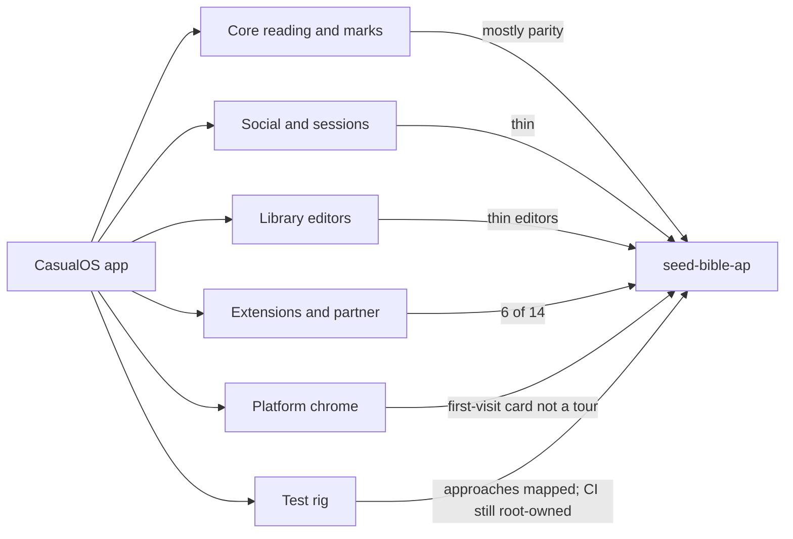

# Gap analysis — CasualOS Seed Bible vs seed-bible-ap

_Last scanned 2026-10-22; gap build in progress (rows marked **closed** were closed by it)._ Sources: managers and components in `packages/seed-bible` (read-only), every `packages/*-extension`, and the **code** under this package (`apps/reader-web` ~88 source files, `ReaderBackend`, `extensions/index.ts`, `test/`). The [training manual](../training-manual.md) is what we tell testers; this page is what the two apps actually do, including how we **test**.

The old CasualOS backend is **not** a gap to close. We do not port `OsManager`, markers, or Yjs tests. We do close user-facing holes and we do match or beat every old **testing approach**.

## Legend

| Mark                 | Meaning                                                     |
| -------------------- | ----------------------------------------------------------- |
| **parity**           | Same user outcome as today                                  |
| **better**           | New stack is stronger                                       |
| **thin**             | Feature exists; a sub-capability the old app had is missing |
| **missing**          | User cannot do it                                           |
| **deferred**         | Later embed / substrate / out of this program               |
| **intentional drop** | We chose not to carry it                                    |
| **closed**           | Test approach exists here (same or better)                  |
| **open**             | Test approach not yet built here                            |

## How to read this

The new app already covers the **happy path**: read a chapter, mark it, sign in at the Home, sync to the person's Library, start a live session, make a playlist / plan / theme, and use six extensions. Gaps are almost all **depth** — editors, tours, partner content, offline downloads, shared pages, host overlays — plus CasualOS-only 3D.

Approximate count of user-facing capabilities in the old app: **~95**.

| Status           | Count | What                                                                                                                                                                                                                                             |
| ---------------- | ----- | ------------------------------------------------------------------------------------------------------------------------------------------------------------------------------------------------------------------------------------------------ |
| Parity or better | ~52   | reading, marks, search, audio/TTS, sign-in, sessions follow, Discover registry, six extensions' core                                                                                                                                             |
| Thin             | ~24   | tours vs card, playlist history, plan editor, gallery/crop, Friends pane, shared pages, session QR, chat record, org-as-publisher, MCP acts, toolbar customizer, testament filter, keyboard, context menu, embed iframe snippet, variant gallery |
| Missing          | ~12   | whole-translation offline download, keyboard nav, toolbar customizer, Apologist, default-content, theographic, Twitch host overlay, playlist history pane, guided tutorials, default-translation-by-UI-language, wake lock                       |
| Intentional drop | ~4    | PostHog, YouVersion, publicRead-everything, Twitch write-to-Twitch                                                                                                                                                                               |
| Deferred         | ~4    | 3D patterns, ao.bot portals, federation visitors, huddle/RealtimeKit                                                                                                                                                                             |

---

## 1. Core reading

| Capability                                              | Old                                                   | New                                          | Gap                                                                                                                                                                       |
| ------------------------------------------------------- | ----------------------------------------------------- | -------------------------------------------- | ------------------------------------------------------------------------------------------------------------------------------------------------------------------------- |
| Chapter text from HelloAO API                           | `FreeUseBibleAPI` (`bible.helloao.org` / `vmfnri`)    | `backend/bible.ts` same API                  | **parity**                                                                                                                                                                |
| Book / chapter / translation picker                     | `BibleSelector` + testament filter, ghost books       | `BibleSelector` + search                     | **closed** (gap build): All / Old / New / Apocrypha chips, empty state for a testament the translation lacks — `state/reading/testaments.ts`                              |
| Next/prev, URL, `?v=` selection                         | `ReadingUrlPath`                                      | `state/reading/route.ts`                     | **parity**                                                                                                                                                                |
| Headings, poetry, red letters, footnotes                | `ChapterText`                                         | `chapterContent.tsx`                         | **parity**                                                                                                                                                                |
| Hide verse numbers / headings / footnotes / red         | Settings                                              | Account checkboxes                           | **parity**                                                                                                                                                                |
| Size, line height, margins, UI scale, fonts             | `SettingsManager` + `ThemeManager`                    | Account + theme CSS vars                     | **thin**: custom font picker is church-theme fields, not a reader font library                                                                                            |
| Light/dark + system                                     | ThemeManager                                          | toolbar + system until chosen                | **parity**                                                                                                                                                                |
| 77 UI locales                                           | `i18n/`                                               | copied locales                               | **parity**                                                                                                                                                                |
| Resume last chapter on device                           | tabs persistence                                      | same                                         | **parity**                                                                                                                                                                |
| Cross-device resume                                     | reading history Yjs year docs                         | history buckets + Today recent               | **parity** of outcome; no year-doc CRDT                                                                                                                                   |
| Offline **re-open** of a seen chapter                   | IDB chapter cache                                     | SW + IDB                                     | **parity**                                                                                                                                                                |
| Offline **download a whole translation**                | `OfflineTranslationsManager`, prompt, store, fallback | BibleSelector comment: not ported            | **closed** (gap build): download per translation in the picker, stored under the reader's offline keys, removable — `state/reading/offlineTranslations.ts`                |
| Tabs, layouts (1 / 2 / 3 / 2×2 / 4 / 1+2), drawer, More | `TabsManager`, `TabsLayoutManager`                    | `tabs.ts`, `PanesLayout`                     | **parity**                                                                                                                                                                |
| Drag pane dividers, remembered widths                   | `PanesManager`                                        | `paneColumns.ts`                             | **parity**                                                                                                                                                                |
| Scroll save/restore per tab, scroll-to-verse            | `TabSlotReader`                                       | `readerViewport.ts`                          | **parity**                                                                                                                                                                |
| RTL/LTR swipe to next chapter                           | TabSlotReader                                         | same viewport helper                         | **thin**: helper exists; prove in a flow if it regresses                                                                                                                  |
| Keyboard nav                                            | `app/keyboardNav.tsx`                                 | not in reader-web                            | **closed** (gap build): ← → chapters (RTL mirrored), ↑ search, Esc closes; the old `keyboardNav` focus helpers in the picker, toolbars and menus — `state/chrome/keys.ts` |
| Context menu on verse                                   | `ContextMenu`                                         | verse toolbar only                           | **closed** (gap build): right-click opens the verse toolbar as a menu at the pointer, plus Copy                                                                           |
| Below-reader toolbar customizer                         | `BelowReaderToolbar`, Settings toolbar                | floating `ReaderToolbar` + Account → Toolbar | **closed** (gap build)                                                                                                                                                    |
| Default translation by UI language                      | `DEFAULT_TRANSLATIONS_BY_LANGUAGE`                    | not ported                                   | **closed** (gap build): the old table, every id checked against the API — `state/reading/defaultTranslation.ts`                                                           |
| Wake lock while audio/reading                           | `OsManager` `navigator.wakeLock`                      | absent                                       | **closed** (gap build): Account setting, held while visible — `state/chrome/wakeLock.ts`                                                                                  |
| Feature flags / PostHog                                 | `FeaturesManager`                                     | absent                                       | **intentional drop** until we need a flag                                                                                                                                 |
| YouVersion sign-in                                      | roadmap / CasualOS                                    | absent                                       | **deferred** (Home is identity)                                                                                                                                           |

## 2. Marks

| Capability                                                                   | Old                                                        | New                                                                                                                          | Gap                                                                                                              |
| ---------------------------------------------------------------------------- | ---------------------------------------------------------- | ---------------------------------------------------------------------------------------------------------------------------- | ---------------------------------------------------------------------------------------------------------------- |
| Highlight 6 colours, replace, clear                                          | `HighlightsManager`                                        | `highlights.ts` + ribbons                                                                                                    | **parity**                                                                                                       |
| Notes TipTap (bold/italic/underline/align) + verse links                     | `AnnotationsManager`, `TipTapEditor`, `VerseReferenceMark` | same files exist                                                                                                             | **parity** of editor                                                                                             |
| Note conflict when two devices edit                                          | `AnnotationConflictModal` + `RecordSyncManager` ask-user   | item-level merge keeps both + "Keep this version"                                                                            | **parity** of outcome; **thin** UI (no keep-theirs / keep-mine / merge)                                          |
| Boxed verse numbers → jump to note                                           | BibleReader                                                | present                                                                                                                      | **parity**                                                                                                       |
| Bookmark chapter + name/colour                                               | `BookmarksManager`                                         | header toggle + Your Content pencil                                                                                          | **parity**                                                                                                       |
| Save chapter + verse range + folders                                         | `SavesManager`                                             | header + verse Save + folders                                                                                                | **parity**                                                                                                       |
| Your Content search (ref + words)                                            | `YourContentManager` + Typesense                           | same                                                                                                                         | **parity**                                                                                                       |
| All-chapters highlights/notes                                                | `listDataByMarker`                                         | `state/records/all.ts` after pull                                                                                            | **parity**                                                                                                       |
| Adopt anonymous device into account                                          | `AdoptDeviceContentModal`                                  | sign-in flush of local outbox (no modal)                                                                                     | **thin**: works without a named ceremony                                                                         |
| `?annotationRecordKey=`: notes kept in a team's shared record, with a banner | `recordOverride` + `AnnotationOverrideBanner`              | a published note's `?offering=` link opens Discover with that note open; notes kept in a church's Library wait on org writes | **parity** for opening one note; **deferred** for team-record notes ([hard-problems.md](./hard-problems.md) §11) |
| Sanitization of pasted HTML                                                  | `Sanitization`                                             | `noteHtml.ts`                                                                                                                | **parity**                                                                                                       |

**Better than old:** marks are private by default (old was `publicRead:*`); one Library write per chapter; the person's own agent writes the record.

## 3. Search, audio, listening

| Capability                                   | Old                                             | New                                     | Gap                                                           |
| -------------------------------------------- | ----------------------------------------------- | --------------------------------------- | ------------------------------------------------------------- |
| Typesense verse search                       | `SearchManager`                                 | `backend/search.ts`                     | **parity**                                                    |
| Local book-name search                       | `bookNameMatch`                                 | `lib/scripture`                         | **parity**                                                    |
| Chapter recording + verse timings + scrubber | `AudioPlaybackManager` + audio-reader extension | built into `audio.ts` + `AudioScrubber` | **parity** of playback; **thin**: no extra extension settings |
| Multiple readers picker                      | audio-reader                                    | Account → Listening                     | **parity**                                                    |
| Auto-play next chapter                       | setting                                         | present                                 | **parity**                                                    |
| TTS fallback                                 | `TextToSpeechManager`                           | `textToSpeech.ts`                       | **parity**                                                    |
| Audio reader as a removable extension        | `packages/audio-reader-extension`               | folded into chrome                      | **intentional drop** of the package; capability kept          |

## 4. Identity and social

| Capability                                                | Old                                                                     | New                                                                    | Gap                                                                                                    |
| --------------------------------------------------------- | ----------------------------------------------------------------------- | ---------------------------------------------------------------------- | ------------------------------------------------------------------------------------------------------ |
| Sign-in                                                   | CasualOS email-code                                                     | Home Connect + Quick Connect + `dev:`                                  | **better**                                                                                             |
| Profile name / bio / photo                                | CasualOS profile + `UserGalleryManager` (24 recent, publicRead gallery) | Account → Your profile; picture in Library                             | **closed** (gap build) for crop and the chooser (`PictureField.tsx`, flow G14); no public gallery page |
| Friends list pane                                         | `FriendsPane`                                                           | Today only                                                             | **closed** (gap build): Friends pane from the sidebar, the same section Today shows                    |
| Friend requests / add back                                | `FriendsManager`                                                        | Home contacts + Today "Add back"                                       | **parity** of outcome; UX lives at the Home                                                            |
| Invite by email                                           | `InvitationsManager` (also used as session registry)                    | Home `/invite/friend`                                                  | **parity** for friends; **missing** invitations-as-session-registry                                    |
| Today: continue, bookmarks, saves, friends, releases      | `TodayManager`, community feed pager                                    | `TodayPane`                                                            | **thin**: no pager / "load more" for a long friends feed                                               |
| Friend content freshness                                  | `friendContentFreshness`                                                | registry crawl ≤15 min                                                 | **thin**: crawl lag is the contract                                                                    |
| Discover chapter notes/playlists/plans/videos             | `DiscoverManager` + extension contributors                              | registry + extension sections (refs, places)                           | **missing** partner contributors (Apologist, default-content, theographic)                             |
| Shared pages (`SharedPagePath`, share modal, public page) | publicRead page + SSR seed                                              | verse `?v=` link + published-note Discover link                        | **closed** (gap build): `/shared/<shelf>/<kind>/<slug>`, edge-rendered with preview tags; flow G12     |
| Presence across the app (not in a session)                | CasualOS presence                                                       | Home `PresenceDO` + Today green dot                                    | **parity** (substrate)                                                                                 |
| Circle / friends-only share                               | everything was publicRead                                               | public or copy-into-circle ([hard-problems.md](./hard-problems.md) §4) | **missing** friends-only without publishing                                                            |

## 5. Live sessions

| Capability                                 | Old                        | New                                                          | Gap                                                                                                                      |
| ------------------------------------------ | -------------------------- | ------------------------------------------------------------ | ------------------------------------------------------------------------------------------------------------------------ |
| Start / join / follow leader / decorations | Yjs inst                   | `ReadingSession` Agents SDK room                             | **parity** of UX                                                                                                         |
| Roles (leader / navigator / decorator)     | SessionsManager            | host `setRole`                                               | **parity**                                                                                                               |
| Session chat                               | `ChatsManager` on CasualOS | room SQLite + broadcast                                      | **thin**: not the ap-home discussion board (`InteractionsDO` / `internal.channels.post`); chat dies if the room is wiped |
| Session QR                                 | `SessionQRCode`            | share link / code                                            | **closed** (gap build): `SessionQRCode` with Save image, same `qrcode` library                                           |
| Guest join                                 | anonymous inst             | `sessionJoinAsGuest`                                         | **parity**                                                                                                               |
| Voice                                      | none in CasualOS           | WebRTC mesh, STUN only                                       | **better** than old; **thin** vs planned huddle/RealtimeKit (no relay)                                                   |
| Shared tabs/panes as one document          | Yjs                        | follow chapter + decorations; each device keeps its own tabs | **thin**: not one shared tab strip                                                                                       |
| Late joiner snapshot                       | Yjs                        | Agents SDK state                                             | **parity**                                                                                                               |

## 6. Library (playlists, plans, themes, files)

| Capability                                                           | Old                                                                         | New                                                                                                           | Gap                                                                                                                                         |
| -------------------------------------------------------------------- | --------------------------------------------------------------------------- | ------------------------------------------------------------------------------------------------------------- | ------------------------------------------------------------------------------------------------------------------------------------------- |
| Playlist items: scripture / html note / link (+ YouTube/Vimeo embed) | `PlaylistManager` types `bible-verse`, `html`, `link`                       | schema `ScriptureItem`, `HtmlItem`, `LinkItem` + embed                                                        | **parity** of model; **thin** editor vs `CreatePlaylistForm` / `PlayPlaylistView`                                                           |
| Playlist history pane                                                | `PlaylistHistoryPane`                                                       | absent                                                                                                        | **closed** (gap build): one row per playlist, by day, Resume / Play again — kept on the device (the old app kept it in a publicRead record) |
| Playlist play next/prev/stop                                         | `PlayPlaylistView`                                                          | player card                                                                                                   | **parity** of core                                                                                                                          |
| Reading plan editor (custom sessions, days, reorder)                 | `ReadingPlanEditor`                                                         | generate "one chapter/day from here" + daily/self-paced                                                       | **closed** (gap build): `PlanEditor.tsx` + `planEdits.ts`; flow G13                                                                         |
| Plan friends / shared plans                                          | `ReadingPlansPaneFriends`                                                   | publish → Discover only                                                                                       | **missing** friends-only plans                                                                                                              |
| Customization editor                                                 | `CustomizationEditPane`, variant gallery, extension prefs, dockable preview | Library → Customizations: colours L/D, logo, default translation, recommended extensions, Google Fonts fields | **thin**: no variant gallery beyond L/D, no `DockableThemeLivePreview`, no logo crop                                                        |
| Org publishes as church                                              | org record                                                                  | Account → **Publish as** (steward orgs)                                                                       | **thin**: true org-Library writes wait on hard-problem §11                                                                                  |
| Hero / photo chooser / public files                                  | `uploadPublicFile`, `PhotoChooser`                                          | `uploadFile` → R2 + Library catalog                                                                           | **closed** (gap build): `PictureField.tsx` crop + Earlier pictures; flow G14                                                                |
| Link previews                                                        | `OsManager.getLinkPreview`                                                  | svc `/preview`                                                                                                | **parity**                                                                                                                                  |
| Partner chapter content                                              | Apologist, default-content, theographic                                     | Discover lists registry + local ext only                                                                      | **missing**                                                                                                                                 |

## 7. Extensions — 6 shipped of ~14

[`extensions/index.ts`](../../apps/reader-web/src/extensions/index.ts) registers: compare, references, locations, companion, twitch (watch), transcript.

| Extension                                      | Old                                                         | New                                                | Gap                                                             |
| ---------------------------------------------- | ----------------------------------------------------------- | -------------------------------------------------- | --------------------------------------------------------------- |
| Compare                                        | `compare-extension`                                         | `extensions/compare`                               | **parity**                                                      |
| Cross-references                               | `references-extension`                                      | Discover section                                   | **parity** of list                                              |
| Locations list + map                           | `locations-extension`                                       | Discover list + Places map                         | **parity** of map                                               |
| Bonfire / AI chat                              | `bonfire-extension`, `AIManager`, `ChatView`                | study companion `/companion/ask`                   | **thin**: no org Bonfire persona / discussion turn              |
| Twitch **watch**                               | twitchSub embed                                             | read-only player+chat embed                        | **parity** of watch                                             |
| Twitch **host** (post to Twitch chat, overlay) | `twitchPub-extension`                                       | **intentional drop** (no write outside the estate) | **missing** by rule                                             |
| Transcript + transcript-ui                     | device decode + `os.client.aiChat` / Netlify key            | device decode + estate speech model, save as note  | **parity** of read path; **better** (no browser key)            |
| External MCP **acts**                          | `mcp-extension` calls user servers                          | list connectors only                               | **missing** invocation                                          |
| Apologist                                      | `apologist-extension`                                       | absent                                             | **missing** (org offering)                                      |
| default-content                                | `default-content-extension`                                 | absent                                             | **missing**                                                     |
| theographic people/places/events               | `theographic-extension`                                     | absent                                             | **missing**                                                     |
| audio-reader package                           | extra UI on playback                                        | folded in                                          | **intentional drop**                                            |
| example / refresh                              | template                                                    | absent                                             | **missing** (not product)                                       |
| Extension settings + sensitive keys            | `ExtensionSettingsForm`, `SensitiveSettings`, `recordProxy` | enable/disable on device                           | **thin**: no per-extension settings schema, no vault secrets UI |
| Customization-forced extension prefs           | `CustomizationExtensionPreferencesManager`                  | recommended ticks only                             | **thin**                                                        |

## 8. Platform chrome

| Capability                                                      | Old                                   | New                                     | Gap                                                                                                |
| --------------------------------------------------------------- | ------------------------------------- | --------------------------------------- | -------------------------------------------------------------------------------------------------- |
| SSR chapter + OG + canonical + sitemap + robots                 | `server/`, `ssrEnv`                   | Worker SSR                              | **parity**                                                                                         |
| PWA / SW / precache / chunk retry                               | Vite PWA + `retryChunkImport`         | `src/sw/*`                              | **parity**                                                                                         |
| Embed `?embed=minimal\|true`, `?theme=`, `?customization=`      | `EmbedMode` (`app.themeId`)           | `?embed=`, `?theme=`, `?customization=` | **closed** (gap build): Share dialog → Embed (iframe code, theme, preview); `app.themeId` accepted |
| First-visit card                                                | `OnboardingManager`                   | `Onboarding.tsx`                        | **parity** of card                                                                                 |
| Guided tutorials (desktop + mobile + contextual + `?tutorial=`) | `TutorialManager` many steps          | **closed** (gap build)                  | `state/chrome/tours.ts` + `Tour.tsx`; flow G11                                                     |
| About + ToS / privacy / code of conduct                         | legal modals                          | About pane + policy bundles             | **parity** of texts; acceptance not persisted (old also did not persist)                           |
| Settings page                                                   | `SettingsPage`, `MobileSettingsSheet` | everything in `AccountPane`             | **thin** UX, not missing capability                                                                |
| Login modal                                                     | CasualOS                              | Home popup / redirect                   | **better**                                                                                         |
| Hydration mismatch / commit guard                               | `hydrateWithFallback`                 | `hydrate.tsx`                           | **thin**: fewer decline cases than the old standalone suite                                        |

## 9. CasualOS-only / later embed

| Capability                           | Gap          |
| ------------------------------------ | ------------ |
| Bible Stack 3D                       | **deferred** |
| House of the Lord 3D                 | **deferred** |
| Other `patterns/` (geo-importer)     | **deferred** |
| `PortalComponent` / `ao.bot` iframes | **deferred** |
| `obsolete/` viz                      | not coverage |

---

## 10. Test rig — old approaches vs this package

The old repo's quality process is inventoried in [test-plan.md](../test-plan.md). About **406** unit files, **2** integration, **6** dead Puppeteer e2e (not in CI). Root CI (`pnpm lint`, `check:ts`, `test:coverage`, build-size comment) **does not run this package** (`eslint.config.mts` ignores `packages/seed-bible-ap/**`). Until a root CI job is approved, `pnpm gate` and the smokes run by hand.

We do **not** copy CasualOS tests. We copy **approaches**. New approaches the old suite never had sit at the bottom.

### 10.1 Approaches the old suite had

| #   | Old approach                                                   | Old home                                                        | New equivalent                                                                                         | Status                                                                        |
| --- | -------------------------------------------------------------- | --------------------------------------------------------------- | ------------------------------------------------------------------------------------------------------ | ----------------------------------------------------------------------------- |
| 1   | Full-state fixture `createTestSeedBibleState`                  | `test/unit/seed-bible/testUtils/`                               | `test/helpers/createTestReaderState.ts` over `createReaderState` + `createDevBackend` + `memoryStores` | **closed** — `test/integration/fixtures.test.ts`                              |
| 2   | jsdom component tests, `TestHost`, aria/role                   | 113 component files                                             | Vitest `jsdom` project, `TestHost.tsx`, `@testing-library/preact`                                      | **closed** — `testHost.test.tsx`; still fewer rendered panes than the old 113 |
| 3   | `blockRealSockets`                                             | `test/setup/blockRealSockets.ts`                                | same + `blockRealFetch` (ADR-0044: browser never calls MCP/svc)                                        | **better**                                                                    |
| 4   | Fake timers + `waitFor` polling                                | 54 + 68 files                                                   | `vi.useFakeTimers`, `until()`                                                                          | **closed** as a pattern; used in session-expiry and viewport                  |
| 5   | Offline/sync matrix (`RecordSyncManager`)                      | pending upsert/delete/conflict                                  | `outbox.test.ts` + `two-devices.test.ts` on buckets                                                    | **closed** / **better** (item-level merge)                                    |
| 6   | Hydration + no-storage-at-boot ESLint rule                     | `standalone/hydration.test.tsx`, `noImmediateStorageAccessRule` | `hydration.test.tsx`, `no-storage-at-boot.test.tsx` (test replaces the root rule we cannot edit)       | **closed**                                                                    |
| 7   | SW routing, precache, chunk retry                              | `swRouting`, `precacheManifest`, `retryChunkImport`             | same three tests over `apps/reader-web/src/sw/`                                                        | **closed**                                                                    |
| 8   | SSR bundle check after build                                   | `check-ssr-bundle.ts`, `ssr-smoke.mjs`                          | `pnpm smoke:ssr` (`scripts/check-ssr-bundle.ts` via wrangler `unstable_dev`)                           | **closed**                                                                    |
| 9   | Viewport/gesture integration                                   | `TabSlotReader.test.tsx`                                        | `test/integration/reader-viewport.test.tsx`                                                            | **closed**                                                                    |
| 10  | Sanitization, session guard, telemetry hygiene                 | `Sanitization`, `SessionGuard`, `telemetry`                     | `sanitization.test.ts`, `session-expiry.test.ts` (two credentials), `log-hygiene.test.ts`              | **better** (id_token + ask-as-me wire)                                        |
| 11  | i18n lint (missing/unused/incomplete/untranslated, 77 locales) | `script/eslint/i18n*.ts`                                        | `i18n-keys.test.ts` — **English only**, by decision                                                    | **thin**: other 76 locales not gated                                          |
| 12  | Typecheck, Prettier, coverage, size **diff vs base branch**    | root CI, 50 KB comment                                          | `pnpm typecheck`, repo pre-commit, `test:coverage`, `pnpm size` **absolute** budgets                   | **thin**: no PR size-diff comment; no root CI job                             |
| 13  | Theme snapshot                                                 | one `.snap`                                                     | explicit asserts in `places-and-themes.test.ts`                                                        | **closed**                                                                    |
| 14  | Puppeteer two-browser e2e                                      | `obsolete/test/e2e/` — **dead**, not in CI                      | `smoke:session`, `smoke:reader-web`, Playwright `pnpm e2e` (`test/e2e/flows.ts`) against faithnet      | **better**                                                                    |

### 10.2 Approaches the old suite never had (new, keep)

| Approach                                | Why it exists                                                       | Where                                                                                                                           |
| --------------------------------------- | ------------------------------------------------------------------- | ------------------------------------------------------------------------------------------------------------------------------- |
| Protocol smokes against live principals | Vault, registry, rebuildability (ADR-0055) cannot be faked honestly | `pnpm smoke:vault`, `smoke:svc`, `smoke:rebuild`                                                                                |
| Schema ↔ ontology ↔ skill skew          | Capability lives in three places                                    | `seed-schema.ttl.test.ts`, `pins.test.ts`, `seed-protocol.context-ref.test.ts`                                                  |
| Authority                               | Standing, wires, room roles                                         | `wires.test.ts`, `room-authority.test.ts`                                                                                       |
| Fake Home / Library / person agent      | CI cannot mint people                                               | `fakeHomeJwks.ts`, `fakeLibrary.ts` (ap-home `effectiveAccessPolicy` / `publicShelf`), `fakePersonAgent.ts`, `fakeWorkspace.ts` |
| Publish without Library reads           | Estate rule                                                         | `publish-without-reads.test.ts`                                                                                                 |

### 10.3 Test-rig gaps still open

These are the holes in **how we validate**, not in the reader UI.

| Gap                                             | Old had                                             | New has                                                      | Close how                                                                                                           |
| ----------------------------------------------- | --------------------------------------------------- | ------------------------------------------------------------ | ------------------------------------------------------------------------------------------------------------------- |
| Root CI does not run this package               | lint + typecheck + coverage + size-diff on every PR | `pnpm gate` by hand                                          | Exception to the scope rule: one job in `.github/workflows/` that `cd packages/seed-bible-ap && pnpm gate`          |
| 77-locale completeness lint                     | four ESLint rules                                   | English keys only                                            | Keep the decision, or add a "en.json keys exist" reminder in PRs that add `t()`; do not block on translator locales |
| Coverage fail threshold                         | reported, no fail (same)                            | reported, no fail                                            | Keep — a number is not a gate                                                                                       |
| Size **diff vs base**                           | 50 KB PR comment                                    | absolute `size-budgets.json`                                 | Good enough; raise budgets when a chunk is meant to grow                                                            |
| jsdom coverage of every pane                    | 113 component files                                 | a handful (`TestHost`, viewport, hydration, chapter-content) | Add a render test when a pane is the bug; do not chase 113                                                          |
| Playwright flows do not cover thin/missing rows | n/a (Puppeteer dead)                                | 22 flows, all on the happy path                              | Add a flow only when we close the product gap (tutorial, keyboard, offline download, …)                             |
| Live smokes need faithnet + demo roster         | n/a                                                 | `smoke:*`                                                    | Operator access; not a code gap                                                                                     |
| Copied ap-home Library semantics can drift      | n/a                                                 | header on `fakeLibrary.ts`                                   | Re-diff `effectiveAccessPolicy` / `publicShelf` when ap-home changes                                                |

### 10.4 Feature × test coverage (happy path vs hole)

| Product area                           | Automated today                                            | Manual / smoke                    | Untested vs old depth                                          |
| -------------------------------------- | ---------------------------------------------------------- | --------------------------------- | -------------------------------------------------------------- |
| Chapter SSR, nav, theme, locale, embed | e2e R1–R10, `cutover.test.ts`, `ssr.test.tsx`              | —                                 | testament filter, keyboard, toolbar customizer                 |
| Highlights, notes, bookmark, save      | e2e M1–M5, outbox, two-devices                             | `smoke:vault`, `smoke:reader-web` | conflict-card choices, `?annotationRecordKey=`                 |
| Search                                 | e2e C1                                                     | —                                 | —                                                              |
| Discover / Today                       | e2e S1–S2                                                  | `smoke:svc`                       | partner offerings, friends-only, shared page                   |
| Sign-in + Library sync                 | e2e A1                                                     | `smoke:vault`                     | first-run consent ceremony at Home                             |
| Live session follow                    | e2e L1, `smoke:session`, room-authority                    | —                                 | QR, InteractionsDO chat, huddle                                |
| Compare / Places map                   | e2e X1–X2                                                  | —                                 | Apologist, theographic, default-content, Twitch host, MCP acts |
| Playlists / plans / themes             | unit `library.test.ts`, `customizations.test.ts`           | training B3                       | playlist history, full plan editor, crop, org-as-publisher     |
| PWA / SW / hydration                   | sw-routing, precache, retry, hydration, no-storage-at-boot | —                                 | fewer hydration decline cases than old                         |
| Gate                                   | `pnpm gate` = typecheck + test + build + smoke:ssr + size  | six `smoke:*` + e2e               | not on GitHub Actions                                          |

---

## 11. Punch list (product, then tests)

Not a new architecture — work against the existing build order.

1. **Honesty.** Training-manual / feature-map ✅ means the old sub-capabilities exist or were explicitly dropped. Thin/missing rows in §§1–8 stay 🟡 or ⬜ until closed.
2. **Testers will call these regressions** (close next): guided tutorial, keyboard nav, context menu, offline translation download, shared-page URL, `?annotationRecordKey=`, playlist history, full plan editor, photo/logo crop, testament filter, wake lock.
3. **Partner content** after org publish (hard-problem §11): Apologist, default-content, theographic as `seed:Offering`.
4. **Leave dropped:** PostHog until needed, YouVersion, Twitch host write, CasualOS `publicRead`, 3D rewrite.
5. **Test rig:** keep `pnpm gate` + smokes; add a root CI job when the scope-rule exception is approved; add an e2e flow only when a product gap in (2) or (3) closes.

How to run the current gate: [test-plan.md](../test-plan.md) Part B.
