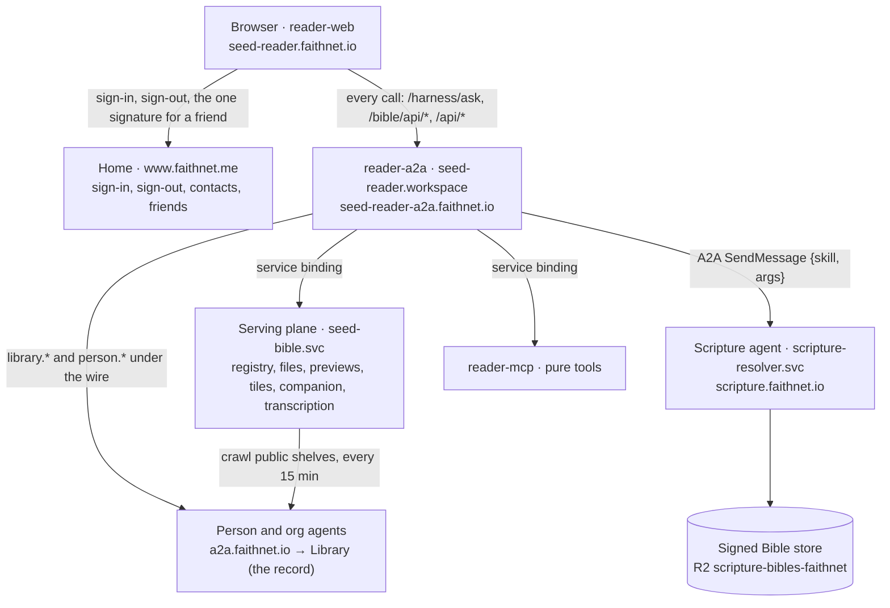

# Seed Bible Reader: New Architecture (A2A and MCP era)

As of 2026-10-22 (revised the same day, after Scripture moved to the scripture agent) · Richard Pedersen

> First exported from the Claude Doc written on 2026-10-22: https://claude.ai/artifact/WgCcrXWeka2hqBseM8Kyrg. This file has since been revised for the scripture agent, on-device verification, in-reader friends and sign-out. Until the Claude Doc is brought in step, this file is the current one.

## What this document covers

This is the reference for the new reader in `packages/seed-bible-ap`, live at seed-reader.faithnet.io. It traces every path from the browser through the reader's agent to the other agents and the MCP tool servers, says what each store holds, and lists what the browser still reaches directly. It ends with a table that maps each piece of the old reader (see [Seed Bible Reader: Old Architecture (CasualOS era)](./old-architecture-casualos.md)) to where that piece lives now.

The new reader is a parallel build for testers. seedbible.org is untouched and no cutover is planned.

**Vocabulary used throughout**

| Term                       | Plain meaning here                                                                                                                                                                                                                                                                             |
| -------------------------- | ---------------------------------------------------------------------------------------------------------------------------------------------------------------------------------------------------------------------------------------------------------------------------------------------- |
| A2A                        | Agent-to-agent protocol. An HTTP service with an agent card that other agents and apps call with a JSON-RPC `SendMessage`. The reader's backend is an A2A agent, not a REST API, and so is the source of Scripture.                                                                            |
| MCP                        | Model Context Protocol. A tool server that answers `tools/list` and `tools/call` over JSON-RPC. Agents call MCP tools; the browser never does.                                                                                                                                                 |
| Harness run                | One request handled by an agent: it plans, calls tools, and returns a result with a run reference. Every ask to the reader agent is one harness run.                                                                                                                                           |
| Home                       | The faithnet identity provider at www.faithnet.me. It signs people in, issues their id_token, and hosts each person's own agent and Library.                                                                                                                                                   |
| Person agent               | Each signed-in person has an agent of their own at the Home. It owns their Library (highlights, notes, bookmarks, works) and answers contact, friend and presence questions.                                                                                                                   |
| Library / vault            | A person's own record store, held by their person agent. The vault is the system of record; anything else is a rebuildable copy.                                                                                                                                                               |
| Workspace agent            | `seed-reader.workspace`, the reader's A2A agent (reader-a2a). It acts for a reader only with that reader's wire.                                                                                                                                                                               |
| Wire (ask-as-me)           | A signed delegation the Home mints at sign-in that lets the workspace agent ask the reader's person agent on their behalf. Stored on reader-a2a, scoped to the `seed-bible` Library folder.                                                                                                    |
| Scripture agent            | `scripture-resolver.svc` at scripture.faithnet.io (from the verifiable-content-demo repository). The one source of Bible text, audio timings, cross-references, Theographic data, verse search and place geometry, all asked as A2A skills.                                                    |
| Corpus attestation         | A credential the scripture agent signs for each translation. It names the translation and a Merkle root (one fingerprint that covers every verse), so a reader can check that a verse belongs to exactly that translation.                                                                     |
| Serving plane              | `seed-bible.svc` (seed-bible-a2a): the place for what people publish about Scripture. It crawls released offerings and indexes them by chapter, and holds published picture copies; it also runs link previews, map tiles, the study companion and transcription. Rebuildable from the vaults. |
| Estate / town / federation | Estate: faithnet (its Home, people, agents). Town: faithchain, chain 34348, where agent identities and names live. Federation: the wider set of towns. Writes stay inside these; everything outside is read-only.                                                                              |
| Custodian                  | The key that controls an on-chain agent account. The demo reader `seedreader` custodies its own account and the workspace agent.                                                                                                                                                               |
| Offering / slice           | A released, signed piece of a reader's or church's content (a note, playlist, plan, customization) that the registry lists for others to discover.                                                                                                                                             |

## The big picture

The browser talks to one backend origin, the reader's workspace agent (reader-a2a), for everything, including the Bible. There is no second source and no fallback: before this revision the page fetched verses from bible.helloao.org and searched Typesense with a key in the page; now both are gone from the browser, and every verse, search hit, cross-reference and place comes from the scripture agent by way of reader-a2a.

Three kinds of thing sit behind reader-a2a:

1. **The reader's own records.** reader-a2a never stores them. It asks the reader's person agent at the Home to read and write the reader's Library, using the delegation (the wire) the Home minted at sign-in.
2. **Scripture.** reader-a2a turns each Bible request into one standard A2A `SendMessage` to the scripture agent, naming a skill (`read-chapter`, `search-verses`, `place-geometry` …). The agent answers from a signed Bible store. The page then checks every verse on the device against the translation's signed fingerprint and marks what it could prove.
3. **What people publish.** The serving plane (seed-bible.svc) indexes released slices for Discover and Today and holds published picture copies. It can be rebuilt from the Libraries.

Read it top down. Sign-in, sign-out and the one signature a friendship needs go to the Home. Everything else goes to reader-a2a, which fans out to four places: the person's agent (the record), the scripture agent (the Bible), the serving plane (the index of what people publish), and the pure tool server. The scripture agent answers from its own signed store, and the serving plane crawls public shelves back out of the Libraries.

| Part                  | Deployed as                                                                 | Host                                                          | Owns                                                                                                                                                                                                                                                                                                                                               |
| --------------------- | --------------------------------------------------------------------------- | ------------------------------------------------------------- | -------------------------------------------------------------------------------------------------------------------------------------------------------------------------------------------------------------------------------------------------------------------------------------------------------------------------------------------------- |
| reader-web            | Cloudflare Worker + static assets                                           | seed-reader.faithnet.io (dev :5185)                           | The Preact UI, Home sign-in via connect-client, the edge render of /read/\* and /shared/\*, sitemap and robots, the PWA service worker, IndexedDB read model and outbox, and the on-device Scripture check. Holds no key.                                                                                                                          |
| reader-a2a            | Worker with Hono + service-host                                             | seed-reader-a2a.faithnet.io (dev :8891)                       | The workspace agent `seed-reader.workspace`. The agent card, /api/a2a, /harness/\*, the Bible path /bible/api/\*, app routes. Verifies id_tokens against the Home's JWKS. D1 table of wires. Durable Objects: the run object, the ReadingSession room, the BucketCache. Service bindings to the scripture agent, reader-mcp and the serving plane. |
| reader-mcp            | Worker, service-bound                                                       | workers.dev only (dev :8890)                                  | Pure tools `hello` and `bucket_merge` on two lanes: POST /tools/\<name> for the agent and POST /mcp for any MCP client. No key, no state.                                                                                                                                                                                                          |
| Scripture agent       | Worker `demo-bible-a2a-faithnet`, in the verifiable-content-demo repository | scripture.faithnet.io                                         | `scripture-resolver.svc` (`0x3064d8…90b2`). Standard A2A at `/api/a2a`. Content skills are answered at once from the R2 store; any other message becomes a harness run. Serves its released, signed agent card.                                                                                                                                    |
| seed-bible-a2a        | Worker with D1, R2, AI, cron                                                | seed-bible-a2a.faithnet.io (dev :8892)                        | The serving plane `seed-bible.svc`: the registry of released offerings (D1 `seed-bible-svc`), public file bytes (R2 `seed-bible-files`), link previews, map tiles, Workers AI for the companion and transcription, a 15-minute crawl. Never the record.                                                                                            |
| seed-bible-mcp        | Worker, service-bound                                                       | seed-bible-mcp.faithnet.io (dev :8893)                        | One pure tool, `offering_validate`, the check a shelf document passes before it is indexed.                                                                                                                                                                                                                                                        |
| Home                  | ap-home, not in this repo                                                   | www.faithnet.me                                               | Sign-in and sign-out (`/logout`), id_tokens, delegations, the client registry, consent, Contacts and friends (and the contact notices that tell someone they were added), the demo roster, one PresenceDO per person.                                                                                                                              |
| Person and org agents | ap-home runtime                                                             | a2a.faithnet.io                                               | Every write to a Library is a harness run on the owner's agent under its own grant. Demo person `seedreader.me`, governing org `seed-reader.org`.                                                                                                                                                                                                  |
| Library (vault)       | Home vault                                                                  | mcp.faithnet.io; public door edge.faithnet.io/api/a2a/\<name> | JSON-LD documents under `seed-bible/<collection>/`, access `public` or `private`, text cap 12,000 characters, public binary cap 1.4 MB.                                                                                                                                                                                                            |
| faithchain            | chain 34348                                                                 | names.faithnet.io, faithnet.town                              | Agent identities, names (priced roots), vault-key bindings. A listing there is a fact, never a grant.                                                                                                                                                                                                                                              |

`pnpm deploy:faithnet` deploys this package's five workers: reader-mcp, reader-a2a, seed-bible-mcp, seed-bible-a2a, then reader-web. The scripture agent deploys from the verifiable-content-demo repository. All hosts are on the faithnet.io zone in the town's Cloudflare account.

## What the browser reaches directly

The browser reaches its own backend origin (reader-a2a) for everything, and the Home for sign-in and sign-out. Apart from those two it loads only fonts, embedded players, and the recorded audio files. It never calls the scripture agent, the serving plane, reader-mcp, the person agent, or any map or geodata source directly, and it holds no API key of any kind. The id_token lives in sessionStorage and is sent as a Bearer header.

| Destination                                                   | Calls                                                                                                                                                                                                                                                                                                                                                                | Why direct                                                                                                                                         | Source                                                                                                                        |
| ------------------------------------------------------------- | -------------------------------------------------------------------------------------------------------------------------------------------------------------------------------------------------------------------------------------------------------------------------------------------------------------------------------------------------------------------- | -------------------------------------------------------------------------------------------------------------------------------------------------- | ----------------------------------------------------------------------------------------------------------------------------- |
| Home (www.faithnet.me)                                        | `/token` (code exchange), `/connect/demo-signin` (Quick Connect), the authorize page in a popup or redirect, `/jwks` through connect-client; `/logout?return=` at sign-out; the add-a-contact page when a friendship needs the person's signature                                                                                                                    | Sign-in, sign-out and signatures belong between the person and their Home; the app only receives the id_token and the wire                         | `apps/reader-web/src/session.ts`, `state/index.ts`, `state/social/friendship.ts`                                              |
| reader-a2a (seed-reader-a2a.faithnet.io, `/a2a` proxy in dev) | `/harness/ask` for every tool call; `/bible/api/*` for every Bible read and verse search; `/api/connect`, `/me`; `/api/public/read`; `/api/presence/beat` and `/api/presence/friends`; `/api/session/guest`; `/companion/ask` (SSE); `/api/transcribe`; `/api/tiles/*`, `/api/tiles-info`, `/api/places/:name`; a WebSocket to `/agents/reading-session/<id>?token=` | The single backend origin                                                                                                                          | `src/api.ts`, `src/backend/a2a.ts`, `src/backend/bible.ts`, `src/backend/search.ts`, `src/backend/room.ts`, extension folders |
| Recorded audio (audio.bible.helloao.org)                      | the MP3 files named in a chapter's audio links                                                                                                                                                                                                                                                                                                                       | The links arrive inside the chapter from the scripture agent; the bytes are large public recordings played by the audio element. Read-only, no key | `src/state/media/audio.ts`                                                                                                    |
| Google Fonts                                                  | Roboto, Inter, Lora stylesheets                                                                                                                                                                                                                                                                                                                                      | Fonts for text style and church customizations                                                                                                     | `src/state/chrome/textStyle.ts`, `customizations.ts`                                                                          |
| Twitch                                                        | player and chat as iframes only                                                                                                                                                                                                                                                                                                                                      | Watch-only embed; nothing is posted                                                                                                                | `src/extensions/twitch`                                                                                                       |
| Google STUN                                                   | `stun:stun.l.google.com:19302`                                                                                                                                                                                                                                                                                                                                       | Voice in a live session is a browser-to-browser WebRTC mesh signalled through the room                                                             | `src/state/sessions/voice.ts`                                                                                                 |

**Gone from the browser in this revision.** bible.helloao.org (and the unused private endpoint vmfnri.helloao.org), its preconnect, its service-worker cache rule, and the Typesense host with its search-only key (`apps/reader-web/.env` was deleted). The unit tests now block every outside host, so a regression that reaches for one fails.

**Never browser-direct, by design.** The scripture agent is reached only through reader-a2a, which caches its answers at the edge. The serving plane is reached only through reader-a2a, so the upload token and the AI binding never reach a page. OpenStreetMap tiles are proxied and cached by the serving plane. The edge public door (edge.faithnet.io) is read by reader-a2a on the browser's behalf.

**Device-only state.** IndexedDB database `seed-bible-reader` has four stores: `buckets` (device copies of Library buckets, plus a stranger's marks held by the zero address), `outbox`, `chapters` (downloaded translations), and `prefs` (reading position, enabled extensions, toolbar layout, chosen customization, publish-as, contact and works caches, playlist history, friends you chose "Not now" for). Person-specific prefs are scoped to the device's owner: when a different person signs in on the same device, the previous person's profile, picture and caches are not shown to them (`state/records/deviceOwner.ts`). localStorage holds `sbr.settings` and `sbr.language`. sessionStorage holds `sbr.session` (the id_token and a wire flag) and the pending-connect marker. Reading position is device-only today; it has a `seed:ReadingPosition` class in the ontology but is not yet written to the Library.

**Edge render and service worker.** The reader-web Worker runs first for `/read/*`, `/shared/*`, `/sitemap.xml` and `/robots.txt`. It renders a chapter fetched through reader-a2a's `/bible/` path, with title, description and Open Graph tags and a `window.__SB_SEED__` cache seed; a shared slice page reads its descriptor and markdown through reader-a2a's public read route. The service worker precaches boot chunks and caches the app shell, assets, `/bible/api/*` responses (stale-while-revalidate) and font files. It never answers `/a2a/`, other `/api/` routes or `/harness/`.

## Web to reader agent (reader-a2a)

Every action a signed-in reader takes becomes one harness run on reader-a2a: the browser posts a one-step plan naming a `seed.*` tool, the agent verifies who is asking, runs the tool, and returns the result with a run reference. Things that need no act (Bible reads, presence, a public read, the companion, tiles, places) go to plain routes on the same origin.

**How the browser is identified.** The Home's id_token is sent as a Bearer header, or as the `session` field of a harness body. reader-a2a decodes the issuer, accepts it only if it is a Home of a served estate (`ESTATE_IDS` is `faithnet`, so www.faithnet.me and its subdomains), fetches `<iss>/jwks`, and verifies ES256 with audience `seed-bible-reader`. The agent address is `canonical_agent_id` or `sub`. In local dev only, `DEV_STUB_SESSIONS=1` admits a `dev:<handle>` token from `DEV_READERS`; it is `0` when deployed. A dev reader has no Home and so no wire. Source: `apps/reader-a2a/src/session.ts`.

**The harness call.** `POST /harness/ask` with `{ session: <id_token>, message, plan: { steps: [{ id: "s1", toolId, args }] } }`. The reply's `results[0].result` is the tool's answer. Signed-out callers may only use `seed.workspace.discover`, `seed.workspace.preview` and `seed.hello`; every other tool refuses a public principal. The browser-side seam is `apps/reader-web/src/backend/ReaderBackend.ts`, with `backend/a2a.ts` as the live implementation and `backend/dev.ts` as the in-memory one for tests. Error codes the UI handles: signed-out, offline, refused, unavailable. While any call is in flight a thin progress line runs across the top of the page (`state/chrome/activity.ts`, `components/chrome/ActivityBar.tsx`).

**Routes on reader-a2a**

| Route                                                                 | Auth                        | What it does                                                                                                                                                                                                  |
| --------------------------------------------------------------------- | --------------------------- | ------------------------------------------------------------------------------------------------------------------------------------------------------------------------------------------------------------- |
| `GET /.well-known/agent-card.json`, `POST /api/a2a`, `ALL /harness/*` | id_token as `session`       | The service-host surface. The card advertises only `seed.hello`; the real tools are reached by a supplied plan. Each ask is one run on the `ReaderRunDO` Durable Object.                                      |
| `GET /bible/api/*`                                                    | none                        | The Bible, in the same paths and shapes the old Bible API used, so the ported client works unchanged. Each path becomes one A2A skill call to the scripture agent (see the next section). Cached at the edge. |
| `GET /bible/api/:t/complete.json`                                     | none                        | A whole translation for offline reading, streamed one `read-book` call per book.                                                                                                                              |
| `POST /api/connect`, `DELETE /api/connect`                            | Bearer                      | Keep or drop the reader's ask-as-me wire. Checks the delegator is the reader, the delegate is this agent's asking key, and the shape is pinned to the skill `harness.ask`. Upserts D1 table `wires`.          |
| `GET /me`                                                             | Bearer                      | The verified reader plus `wire: true` or `false`.                                                                                                                                                             |
| `GET /api/public/read?shelf=&path=`                                   | none                        | Reads a public Library document through the estate's public door at edge.faithnet.io. Used for Discover bodies and shared pages.                                                                              |
| `POST /api/presence/beat`, `GET /api/presence/friends`                | Bearer, forwarded as-is     | Forwarded to the runtime's `/presence/*` under the reader's own token. No harness run, no act. Dev tokens refused.                                                                                            |
| `GET /api/places/:name`                                               | none                        | Asks the scripture agent's `place-geometry` skill and returns the GeoJSON, with its source, licence and how it matched in `x-place-source`, `x-place-license` and `x-place-match` headers.                    |
| `POST /companion/ask`                                                 | Bearer (401 otherwise)      | Proxies to the serving plane's `/companion` with the shared upload token, streams the SSE answer back.                                                                                                        |
| `POST /api/transcribe`                                                | Bearer                      | Audio bytes to the serving plane's `/transcribe` (Whisper on Workers AI).                                                                                                                                     |
| `GET /api/tiles/:z/:x/:y`, `/api/tiles-info`                          | none                        | Proxied to the serving plane's tile cache.                                                                                                                                                                    |
| `POST /api/session/guest`                                             | share code only             | A guest seat in a live session without a Home.                                                                                                                                                                |
| `ALL /agents/*`                                                       | one-time token in the query | Routes the WebSocket to the `ReadingSession` Durable Object.                                                                                                                                                  |
| `POST /hello`, `GET /dev/readers`, `GET /health`                      | none                        | Hello-world lane, dev stub list, service facts.                                                                                                                                                               |

**Tools the browser asks for** (`apps/reader-a2a/src/skills/index.ts`)

| Tool                                                             | What it does                                                                                                      | Where it goes                                                                                           |
| ---------------------------------------------------------------- | ----------------------------------------------------------------------------------------------------------------- | ------------------------------------------------------------------------------------------------------- |
| `seed.bucket.read`, `seed.bucket.list`                           | Read one chapter bucket or a collection's manifest                                                                | Person agent `library.file.read`, cache-first for 10 minutes in the `BucketCache` DO                    |
| `seed.bucket.merge`                                              | Merge a device's bucket into the Library (the outbox flush, one run per bucket)                                   | Person agent read, merge in-process, `library.file.save` bucket then manifest                           |
| `seed.highlight.put`, `seed.annotation.put`, `seed.bookmark.put` | Single-mark puts, idempotent by `seed:opId`                                                                       | Same vault path                                                                                         |
| `seed.publish.slice`, with `withdraw`                            | Release a note, playlist, plan, customization or profile to the owner's public shelf; withdraw sets it private    | Person or org agent `library.file.save` public + `library.file.publish`; then nudges the registry crawl |
| `seed.workspace.discover`                                        | Offerings for a chapter, or recent by owners                                                                      | Serving plane `/registry/offerings`, `/registry/recent`                                                 |
| `seed.workspace.contacts`                                        | The reader's Home contacts                                                                                        | Person agent `person.contact.list`                                                                      |
| `seed.workspace.friends`                                         | Three lists: friends (both added each other), requests (they added the reader), requested (the reader added them) | Person agent `person.friend.list`                                                                       |
| `seed.workspace.orgs`, `.connectors`                             | Organizations the reader stewards; MCP connectors                                                                 | Person agent `person.affiliations.list` (then `person.roles.list`), `mcp.connectors.list`               |
| `seed.session.start`, `.join`, `.record`                         | Start a live session (record first, then room), join by share code, read the record                               | Person agent save of `seed:ReadingSession`; `ReadingSession` DO `/create` and `/invite`                 |
| `seed.work.save`, `.list`, `.read`                               | Playlists, plans, customizations, profile, file catalog as private JSON-LD documents                              | Person agent under `seed-bible/<folder>/`                                                               |
| `seed.file.put`                                                  | A picture into the Library (public) then a copy to the serving plane                                              | Person agent `library.file.save` with bytes; `PUT /files/<owner>/<sha256>.<ext>` on the serving plane   |
| `seed.workspace.preview`                                         | Link preview                                                                                                      | Serving plane `/preview?url=`                                                                           |

**The one key in the system** is reader-a2a's `READER_ASK_PRIVATE_KEY`. Its public address is registered on the Home's `seed-bible-reader` client as `ask_delegate`. The page never holds a key; every Library write is performed by the reader's own agent under the wire the reader approved at sign-in, revocable at the Home under Connected assistants.

## Scripture from the scripture agent

Scripture has one source: the scripture agent at scripture.faithnet.io. It serves, as whole chapters, every edition in its own `list-editions` that has a reader form in its store (today BSB, WEB, KJV and ASV), the cross-reference and Theographic datasets, audio timings, verse search and place geometry. The reader never sees its address; it asks reader-a2a's `/bible/api/*`, and reader-a2a asks the agent.

**How a Bible path becomes an A2A call** (`apps/reader-a2a/src/routes/bible.ts`). reader-a2a maps each path to one skill and sends one standard A2A 1.0 `SendMessage` to the agent's `/api/a2a` over the `SCRIPTURE` service binding (`SCRIPTURE_A2A_URL` in dev). The message carries a single data part `{ skill, args }`. The agent's reply is a data part in the old Bible API's shape; reader-a2a rewrites its links from `/api/` to `/bible/api/`, caches it at the edge, and returns it. A request the agent refuses comes back as a 404 carrying the agent's words. Nothing else is tried.

| Path under `/bible/api/`               | Skill                                         | Answer                                                                                                                                                                                                             |
| -------------------------------------- | --------------------------------------------- | ------------------------------------------------------------------------------------------------------------------------------------------------------------------------------------------------------------------ |
| `available_translations.json`          | `list-translations`                           | The translations the agent serves (its editions with a reader form); any other id is refused                                                                                                                       |
| `<t>/books.json`                       | `list-books`                                  | Books of one translation                                                                                                                                                                                           |
| `<t>/<BOOK>/<ch>.json`                 | `read-chapter`                                | The chapter, with its per-verse proofs, and audio links                                                                                                                                                            |
| `<t>/<BOOK>/<ch>.timing.<reader>.json` | `audio-timings`                               | Word timings for a recording                                                                                                                                                                                       |
| `<t>/complete.json`                    | `read-book`, once per book                    | A whole translation for offline                                                                                                                                                                                    |
| `<t>/attestation.json`                 | `translation-attestation`                     | The signed corpus attestation                                                                                                                                                                                      |
| `d/<dataset>/...`                      | `read-dataset` (`list-datasets` for the list) | Cross-references (open-cross-ref) and Theographic people, places and events                                                                                                                                        |
| `search/<lang>?q=`                     | `search-verses`                               | Verse search: the agent asks its data worker, which ranks with the Seed Bible index where it carries the translation, otherwise searches the translation's own text, and returns the signed corpus text either way |
| reader-a2a `/api/places/:name`         | `place-geometry`                              | OpenBible.info geometry by key; otherwise a Theographic point when the name is unique; a name shared by several places is refused rather than guessed                                                              |

**The signed store** (R2 bucket `scripture-bibles-faithnet`). `catalog.json`; per translation `t/<T>/meta.json` (translation, books, Merkle root, provenance, attestation), `t/<T>/leaves.json` (one commitment per verse) and `t/<T>/b/<BOOK>.json`; datasets under `d/<id>/`; places cached under `places/<name>.json`. The `catalog.json` from the first load is no longer read: the list of translations is built from each served translation's own `meta.json`.

**Adding a Bible** happens inside the scripture service, with no separate writer. The data worker's edition registry (`open-editions.json`) names the edition and the Free Use Bible API translation it is received as. Its `build-open-edition.ts` script receives that translation once and writes both the verse corpus (for the data worker) and the whole-chapter reader form (for the agent) from the same bytes; `put-reader-form.ts` puts the reader form in the store. The agent then lists it, and the first time anyone asks for it, it signs the translation's corpus attestation as `scripture-resolver.svc` through its delegate key and keeps it in the store. Nothing changes in Seed: the new Bible appears in the reader's picker within about fifteen minutes (the agent re-reads its editions every five minutes, and reader-a2a keeps the list for five).

**The check on the device** (`lib/scripture/verify.ts`, `state/reading/scriptureCheck.ts`). For each chapter the reader:

1. checks the translation's attestation once: the credential's shape, that it was signed by a key the scripture agent delegated to, and that it names the expected agent (`VITE_SCRIPTURE_AGENT_SA`);
2. recomputes each verse's commitment from the text on screen and checks its proof up to the attested root.

Each verse ends as verified, text-differs (an alarm mark beside the verse), not-in-corpus, no-commitment, or repeated-number (a translation that numbers two verses the same). The header badge sums the chapter and opens a sheet that explains it. If the agent cannot be reached the badge says so and tries again at most every 30 seconds; being unreachable is never shown as a verdict. The one check not done on the device is the on-chain ERC-1271 confirmation of the agent's signature, which is left to a validator.

**Kept pure A2A.** The agent's public surface is its agent card and `/api/a2a`. Content skills are called with a standard data part and answered at once by a separate standard A2A server inside the agent; every other message goes to its harness. There is no REST Bible API on the agent and no public REST host beside it.

## Reader agent to other agents

reader-a2a owns no reader data. For every record it asks another agent: the reader's person agent for anything in the Library, an organization's agent when a steward publishes as their church, the scripture agent for the Bible, and the serving plane for the index. The rule that makes this safe is that a service-host only admits a wire whose delegator is the host agent itself, so reader-a2a cannot be handed the reader's wire and write as them. Instead it signs a `harness.ask` with its own asking key, attaches the wire, and the person's agent does the write under its own grant.

| From reader-a2a to                           | How it is reached                                                                                                                                                           | What is asked                                                                                                                                                                                                                                                                                                                         | Credential                                                                                                                    |
| -------------------------------------------- | --------------------------------------------------------------------------------------------------------------------------------------------------------------------------- | ------------------------------------------------------------------------------------------------------------------------------------------------------------------------------------------------------------------------------------------------------------------------------------------------------------------------------------- | ----------------------------------------------------------------------------------------------------------------------------- |
| The reader's person agent                    | `POST https://a2a.faithnet.io/harness/ask` with `addressee` = the reader and a supplied plan of `library.*` steps. Read-only plans run `background: true`, `rowsOnly: true` | `library.file.read`, `library.files.list`, `library.file.save` (JSON-LD, markdown, or `bytesB64`, with `accessPolicy` public or private), `library.file.visibility`, `library.file.publish`; and the person tools `person.contact.list`, `person.friend.list`, `person.affiliations.list`, `person.roles.list`, `mcp.connectors.list` | The reader's ask-as-me wire from D1, wrapped with `READER_ASK_PRIVATE_KEY` (`clients/person-agent.ts`)                        |
| An organization's agent (a church)           | Same call, `addressee` = the org's address                                                                                                                                  | The same `library.*` steps so the slice lands on the org's shelf with `publishedBy` = the org                                                                                                                                                                                                                                         | The steward's own wire; the runtime derives steward standing on chain. The separate ask-as-org wire is still an open question |
| The scripture agent (scripture-resolver.svc) | Service binding `SCRIPTURE` to `demo-bible-a2a-faithnet` (`SCRIPTURE_A2A_URL` in dev, else https://scripture.faithnet.io/api/a2a)                                           | A2A `SendMessage` with a data part `{ skill, args }`: the skills in the table above                                                                                                                                                                                                                                                   | None; everything asked is public                                                                                              |
| The serving plane (seed-bible.svc)           | Service binding `PLATFORM` (`PLATFORM_URL` in dev)                                                                                                                          | `GET /registry/offerings`, `/registry/recent`, `POST /registry/crawl` nudge, `PUT /files/...`, `POST /companion`, `POST /transcribe`, `GET /preview`, `/tiles/*`                                                                                                                                                                      | Shared secret `PLATFORM_UPLOAD_TOKEN` (equals the svc's `UPLOAD_TOKEN`) for uploads and AI; none for reads                    |
| The public door                              | `https://edge.faithnet.io/api/a2a/<shelf>`                                                                                                                                  | `library.public.read` of one public document                                                                                                                                                                                                                                                                                          | None                                                                                                                          |
| The runtime's presence objects               | `${A2A_URL}/presence/beat`, `/presence/friends`                                                                                                                             | A beat for the chapter on screen; the friends' current places                                                                                                                                                                                                                                                                         | The reader's own id_token, forwarded unchanged                                                                                |
| reader-mcp                                   | Service binding `MCP` (`MCP_URL` in dev)                                                                                                                                    | `/tools/hello`. The `bucket_merge` tool exists there but `seed.bucket.merge` calls the same merge function in-process                                                                                                                                                                                                                 | None                                                                                                                          |

**Which agents exist and what each owns**

| Agent                    | Type         | Address        | Owns                                                                                                                                      |
| ------------------------ | ------------ | -------------- | ----------------------------------------------------------------------------------------------------------------------------------------- |
| `seedreader.me`          | person       | 0xdbb41f…b3db  | The demo reader's Library and treasury; custodies the workspace with the same key (salt 1). In the Home's demo roster for Quick Connect   |
| `seed-reader.workspace`  | workspace    | 0x5DD5f3…d307F | reader-a2a's identity. Standalone, no governing organization paired yet                                                                   |
| `seed-reader.org`        | organization | 0x0D6f3D…cEA26 | The governing org; the demo church that publishes as itself. Steward link, vault key and the org-steward playbook were set on 2026-10-22  |
| `seed-bible.svc`         | service      | 0x8f627e…9333c | seed-bible-a2a's identity; its own vault key bound                                                                                        |
| `scripture-resolver.svc` | service      | 0x3064d8…90b2  | The scripture agent's identity; signs corpus attestations through its delegate key. Its steward is `ruth.me`. Not part of this repository |

A person's agent offers Library reads only from an assigned playbook. Today that is the estate baseline `agentic-trust/person-steward`; the `seed-reader` archetype cannot replace it yet because five seed skills share the first tool id `library.file.read`. New Homes are born with the playbook; older people get it during the reader's sign-in ceremony through the Home's self-heal, or by hand with `scripts/assign-playbook.mjs`. The seed skills themselves live in the separate skills repository and are pinned here by digest in `apps/reader-a2a/src/pins/skills.json`.

**The serving plane's own agent surface.** seed-bible-a2a also exposes an agent card and two public tools, `seed.svc.registry.query` and `seed.svc.registry.reindex`, on its `SvcRunDO`. Its crawl talks to person and org agents only through the public door, with no credential, and only lists and reads.

**What the serving plane is for.** Its focus is what people publish about Scripture: the registry and the published picture copies. It also still runs four things that are not about people: link previews, map tiles, the study companion and transcription. Places already moved to the scripture agent in this revision; where the other four should live is an open question below.

## MCP servers and every store

The MCP servers in this package hold nothing. They are pure functions behind a JSON-RPC lane, and the data they operate on is passed in with each call. Everything persistent lives in one of the stores below, and only one of those, the person's Library, is a reader's record. The Bible store is the scripture agent's own, outside this repository.

**The MCP servers**

| Server         | Tools                                                                                                                                              | Lanes                                                                                                                        | State                                                                                               |
| -------------- | -------------------------------------------------------------------------------------------------------------------------------------------------- | ---------------------------------------------------------------------------------------------------------------------------- | --------------------------------------------------------------------------------------------------- |
| reader-mcp     | `hello`; `bucket_merge` (merge a current and an incoming bucket for highlights, annotations, bookmarks or saves, same rule as the Library path)    | `POST /tools/<name>`; `POST /mcp` with `initialize` (protocol 2025-06-18), `ping`, `tools/list`, `tools/call`; `GET /health` | None. No key, no bindings, one var `WORKSPACE_NAME`                                                 |
| seed-bible-mcp | `offering_validate` (parse a `seed:Offering`, check `publishedBy` equals the shelf owner, return the chapter, kind, title and id it indexes under) | Same two lanes plus `/health`                                                                                                | None. The crawl currently validates in-process with the same schema rather than calling this worker |

**What is stored where**

| Store                                                           | What is in it                                                                                                                                                                                                                                                                                                                                                                                                                     | Written by                                                                           | Read by                                                                                                       | Rebuildable from                                                                                                                                    |
| --------------------------------------------------------------- | --------------------------------------------------------------------------------------------------------------------------------------------------------------------------------------------------------------------------------------------------------------------------------------------------------------------------------------------------------------------------------------------------------------------------------- | ------------------------------------------------------------------------------------ | ------------------------------------------------------------------------------------------------------------- | --------------------------------------------------------------------------------------------------------------------------------------------------- |
| Person or org Library (the vault, at the Home)                  | Buckets `seed-bible/<collection>/<BOOK>/<ch>.jsonld` for highlights, annotations and history; single buckets `bookmarks.jsonld`, `saves.jsonld`, `progress.jsonld`; a `_manifest.jsonld` per collection; works under `playlists/`, `plans/`, `customizations/`, `profile/`, `files/`; pictures as public documents `files/<sha256>.<ext>`; released slices under `public/<kind>/<slug>.jsonld` plus `.md`; `sessions/<id>.jsonld` | The owner's own agent, asked over the wire by reader-a2a                             | reader-a2a as the reader; the serving plane and `/api/public/read` through the public door, public files only | It is the record                                                                                                                                    |
| Bible store, R2 `scripture-bibles-faithnet` (scripture agent's) | Catalogue, per-translation meta, verse commitments and books, datasets, cached places (see the section above)                                                                                                                                                                                                                                                                                                                     | The data worker's edition scripts; the agent writes attestations and its place cache | The scripture agent                                                                                           | Rebuilt from the edition registry with `build-open-edition.ts` and `put-reader-form.ts`                                                             |
| reader-a2a D1 `seed-reader-a2a`                                 | Table `wires` (reader, wire_json, connected_at): one ask-as-me delegation per reader                                                                                                                                                                                                                                                                                                                                              | `POST` and `DELETE /api/connect`                                                     | Every act tool                                                                                                | A new sign-in                                                                                                                                       |
| reader-a2a Durable Objects                                      | `ReaderRunDO`: harness run checkpoints and records. `ReadingSession`: synced state (host, leader, passage, participants, decorations, guests, sequence, record ref) and SQLite tables `invites`, `ops`, `chat`, `codes`. `BucketCache`: last bucket text per reader, keyed folder/name                                                                                                                                            | Runs; session tools and room callables; vault reads and saves                        | The harness; room clients over WebSocket; vault reads                                                         | Runs are audit only. A session rebuilds from the Library's `seed:ReadingSession` record (chat and ops are lost). BucketCache expires and is re-read |
| reader-a2a edge cache                                           | Answers from the scripture agent under `/bible/api/*` and `/api/places/*`, each with its own lifetime (the translation list five minutes, chapters a day); a hit is handed back with that lifetime rather than the zone's four-hour browser default, and a `CACHE_EPOCH` in `routes/bible.ts` retires everything cached before                                                                                                    | Each route on first miss                                                             | Same routes                                                                                                   | The scripture agent                                                                                                                                 |
| Serving plane D1 `seed-bible-svc`                               | `shelves` (name, endpoint, kind, registered_at): configuration, seeded with `seedreader.me` and `seed-reader.org`. `offerings` (owner, entry_id, shelf, version, release_id, release_signed, passage, passage_ref, kind, title, descriptor_id, descriptor_json, markdown_path, indexed_at, withdrawn_at). `crawl_log`                                                                                                             | The 15-minute cron, `POST /registry/crawl`, `/admin/reindex`                         | `/registry/*`, `seed.svc.registry.query`                                                                      | `offerings` and `crawl_log` from the public shelves (`/admin/wipe` then reindex). `shelves` is configuration                                        |
| Serving plane R2 `seed-bible-files`                             | `<owner>/<sha256>.<ext>` picture bytes, immutable cache headers, 5 MB cap                                                                                                                                                                                                                                                                                                                                                         | `PUT /files/*` from `seed.file.put`; the crawl's refill                              | `GET /files/*` by anyone                                                                                      | The Library's public `seed-bible/files` documents                                                                                                   |
| Serving plane edge cache                                        | Link previews (one day), tiles (one week, zoom 12 and under); reader-web's sitemap (one day)                                                                                                                                                                                                                                                                                                                                      | Each route on first miss                                                             | Same routes                                                                                                   | Upstream                                                                                                                                            |
| Device IndexedDB `seed-bible-reader`                            | `buckets`, `outbox`, `chapters`, `prefs` (see the browser section)                                                                                                                                                                                                                                                                                                                                                                | The state layer through `ReaderStores`                                               | State, extension host, outbox                                                                                 | Buckets and prefs from the Library; chapters from the scripture agent. The outbox and any unsigned-in marks are not rebuildable until flushed       |
| Device localStorage and sessionStorage                          | `sbr.settings`, `sbr.language`; `sbr.session`, `sbr.connect.pending`                                                                                                                                                                                                                                                                                                                                                              | Settings, i18n, session modules                                                      | Same                                                                                                          | Re-choose; re-sign-in                                                                                                                               |
| The Home                                                        | id_token issuance and JWKS; the wire under Connected assistants; one `PresenceDO` per person (beats lapse in 90 s); contacts, friends, affiliations; contact notices in each person's inbox (who added them); MCP connectors; the demo roster; the Library itself                                                                                                                                                                 | The Home and the person's agent; beats forwarded by reader-a2a                       | reader-a2a for verification, presence, contacts, friends, orgs, connectors                                    | Outside this repo; the reader only reads it and forwards beats                                                                                      |

**Bucket and merge rules** (`lib/library-client/index.ts`). A bucket is one JSON-LD document with a `@graph` of items. A put with an `opId` already present changes nothing (replay-safe); the same `@id` replaces; otherwise it appends. A merge is keyed by `@id`: same opId keeps; a superseding edit wins (`seed:supersedes` names the opId it was made from); otherwise the newer `updatedAt` wins with ties to the incoming; two notes that differ and neither supersedes the other are kept side by side with `conflictOf`, and the notes pane's Keep this version settles it. Text cap per document is 12,000 characters. Manifests record each bucket's Library version, count and updated time and are the index and change feed, though the change feed is not consulted yet.

## End-to-end flows

Each flow below is traced hop by hop. The pattern repeats: the browser writes to IndexedDB first, the outbox flushes one merge run per bucket to reader-a2a, and reader-a2a asks the person's agent to write the Library. Anything shared goes through a public shelf and the registry. Anything about the Bible goes through reader-a2a to the scripture agent.

**Sign in (Home lane)**

1. Account pane (or the sign-in button in the phone header), Sign in with faithnet: the browser opens the Home's authorize page in a popup (PKCE), with a full-page redirect as the fallback, and asks for the `ask-as-me` delegation template.
2. The person approves the reader and the wire at the Home; the Home self-heals the person's playbook if it is missing.
3. The browser exchanges the code at the Home's `/token` and gets the id_token and the delegation.
4. The browser posts the delegation to reader-a2a `/api/connect` with the id_token. reader-a2a verifies the token against the Home's JWKS, checks the wire's delegator, delegate and shape, and upserts it in D1.
5. The device is claimed for this person (a different previous person's profile and caches are set aside) and the page reloads itself into the signed-in reader, so no manual refresh is needed. `GET /me` reports `wire: true`. In the background the device pulls the highlights, annotations and history manifests and buckets, and the outbox flushes any marks made while signed out, adopting them with fresh opIds.

Quick Connect collapses steps 1 to 3 into one `POST /connect/demo-signin` for a person in the Home's demo roster. The dev reader is local only.

**Sign out**

1. Sign out drops the wire (`DELETE /api/connect`), forgets the session on the device, and sends the browser to the Home's `/logout?return=<reader origin>/`.
2. The Home ends its own session and returns to the reader's home page, signed out. The next sign-in therefore asks who is signing in rather than reusing the last person.

**Read a chapter**

1. First paint for `/read/<translation>/<book>/<chapter>` is rendered at the edge by the reader-web Worker from reader-a2a's `/bible/` path, with Open Graph tags and a seed the client adopts if route, build and seed match.
2. The client asks `/bible/api/<t>/<BOOK>/<ch>.json` on reader-a2a, which sends `read-chapter` to the scripture agent and caches the answer. The chapter is stored in IndexedDB `chapters`, and the service worker caches the response. Downloaded translations serve offline.
3. The Scripture check runs on the device: the translation's attestation once, then every verse's proof (see "Scripture from the scripture agent"). The header badge and the verse marks show the result.
4. Marks come from the device bucket first. If signed in and online, `seed.bucket.read` asks reader-a2a, which answers from the BucketCache or reads `seed-bible/highlights/JHN/3.jsonld` through the person's agent, and the result is merged into the signal.
5. After 8 seconds on the chapter a `seed:ReadingEvent` is added to the history bucket and queued, one event per chapter per day.

**Search verses**

1. The search box asks `/bible/api/search/<lang>?q=&translation=` on reader-a2a.
2. reader-a2a sends `search-verses` to the scripture agent, which asks its data worker. The data worker ranks the verses with the Seed Bible index when it carries the translation (an edition it does not carry says `"searchIndex": false` and is searched in its own text), and every verse shown is read back from the signed corpus. The browser holds no key.

**Make a highlight**

1. Select a verse, pick a colour. The highlight is applied to the device bucket in IndexedDB and an outbox entry is queued for that bucket with a batch id.
2. The outbox flushes (signed in, wire present, online): one `seed.bucket.merge` harness run per touched bucket, three at a time, marks before history, retried with the same batch id so the far side stays idempotent.
3. reader-a2a reads the bucket through the person's agent, merges, saves the bucket by id, then saves the collection manifest off the critical path.
4. The person's agent admits the wire and writes its own Library. The receipt carries the merged bucket; the device takes it as truth. Delete is a tombstone item.

**Write and publish a note**

1. Select, Note, write in TipTap, Save. A `seed:Annotation` item, with `supersedes` naming the opId it was edited from, follows the highlight path into `seed-bible/annotations/<BOOK>/<ch>.jsonld`.
2. Publish from the notes pane calls `seed.publish.slice` with kind `note`, the passage, title and markdown.
3. reader-a2a asks the person's agent to save the `seed:Offering` descriptor and the markdown under `seed-bible/public/note/<slug>` as public, then to publish each (a signed release). It nudges the registry's crawl.
4. The serving plane lists and reads the public shelf through the public door, validates the offering, and indexes it by chapter in D1. Withdraw sets the documents private; the next crawl writes a tombstone.

The loop closes at Discover: the browser asks reader-a2a, reader-a2a queries the registry, and the body of a chosen item is read back from the owner's shelf through the public door.

**Discover**

1. The compass opens Discover for the chapter. `seed.workspace.discover` goes to reader-a2a, which queries the registry's `/registry/offerings?passage=JHN.3` over the service binding.
2. A chosen item's body is read with `GET /api/public/read?shelf=&path=` on reader-a2a, which reads the public document at edge.faithnet.io with no credential. Signed-out readers can do both.
3. Extensions add local sections. Cross-references and Theographic people and places come from the scripture agent's datasets (`read-dataset`); places on the map come from `/api/places/:name` (`place-geometry`), drawn over tiles from the serving plane, with OpenBible.info and Theographic credited on the map. Today's friends feed uses `seed.workspace.friends` then `/registry/recent` by owner.

**Start and join a live session**

1. The host opens the session pane; `seed.session.start` runs on reader-a2a.
2. reader-a2a saves a private `seed:ReadingSession` record at `seed-bible/sessions/<id>.jsonld` in the host's Library first, then creates the `ReadingSession` Durable Object and mints a one-time token (5 minutes) and a share code.
3. The browser opens a WebSocket to `/agents/reading-session/<id>?token=` on reader-a2a's origin; the room spends the token and sends the state snapshot. The pane shows the Session ID and the Code as two labelled values, and the share link carries both.
4. A joiner follows the share link `?session=<id>&code=<code>`: `seed.session.join` when signed in, or `POST /api/session/guest` with a name when not. Both get a token for the same WebSocket.
5. Follow the leader, decorations, chat, roles and presence are callables on the room, validated against the admitted actor. Chat lives in the room's SQLite. Voice is a browser-to-browser WebRTC mesh signalled through the room and never stored.

**Add a picture**

1. The device shrinks the image to the Library's 1.4 MB public cap, then calls `seed.file.put`.
2. reader-a2a asks the person's agent to save the bytes as a public document `seed-bible/files/<sha256>.<ext>` (the record), then puts a copy to the serving plane's R2 with the shared upload token.
3. A `seed:GalleryImage` work in `seed-bible/files/` catalogs it. Pages load the R2 copy from seed-bible-a2a.faithnet.io. The crawl's refill re-puts any copy R2 lacks. A profile picture is a reference in the `seed:Profile` work, so it follows the reader to every device they sign in on.

**Friends, inside the reader**

Being friends is two contact grants, each signed by its own person at their Home. The reader does everything else in place; only the signature opens the Home.

1. **Send your link.** Today and the Account pane offer the reader's friend link, `https://seed-reader.faithnet.io/friend/<address>?name=<name>`, to copy or share.
2. **Ask.** Opening someone's link (or choosing Add on a request) opens the Home's add-a-contact page for that person, where the reader grants and signs as themselves. The reader then watches `seed.workspace.friends` for up to 3 minutes and shows "Asked" only once the Home has recorded it.
3. **They hear about it.** When someone adds a person, the Home delivers a contact notice into the added person's inbox. Their `person.friend.list` reports that person under requests, so the request appears on their Today in the reader, with Add back and Not now. Not now is kept on that device only; declining is doing nothing.
4. **Friends.** Once both have added each other, both appear in each other's friends list. Everyone who is already a friend at the Home shows up in the reader without any step.
5. **Presence.** Every 30 seconds while signed in, visible and sharing, the browser posts a beat with the chapter on screen to reader-a2a, which forwards it under the reader's own token to the runtime's presence object. A beat lapses in 90 seconds. Today asks `/api/presence/friends` and shows a green dot and the chapter for each friend; tap to open it.

**Ask the companion**

1. The flame icon or the verse toolbar's Ask posts to `/companion/ask` on reader-a2a with the id_token; signed-out readers get 401.
2. reader-a2a forwards to the serving plane's `/companion` with the shared token. Workers AI runs the Llama 3.1 8B model and streams; the SSE stream passes back through reader-a2a, with a leading `who` event naming the answerer.
3. Transcription follows the same shape through `/api/transcribe` to Whisper on the serving plane; the device decodes audio and never sends silence.

**Church theme (customization)**

1. The Library pane's Customizations tab saves a `seed:Customization` work (variants with theme variables, logo, default translation, recommended extensions) through `seed.work.save` into `seed-bible/customizations/`.
2. Publish releases it as a slice of kind `customization`; the registry lists it by kind.
3. A reader picks it under Account, Church theme, or arrives with `?customization=<slug>`; the choice is kept on the device and the variant is overlaid on the built-in light and dark themes.

**A church publishes as itself**

1. A steward picks the church under Account, Publish as; the list comes from `seed.workspace.orgs` (`person.affiliations.list`).
2. `seed.publish.slice` with `as` set to the org's address makes reader-a2a address every `library.*` step to the org's agent with the steward's own wire. The runtime derives steward standing on chain; `publishedBy` is the org and the slice lands on the org's shelf.
3. Prerequisites, done once per church from ap-home: the steward link, a bound vault key, the org-steward playbook, and the shelf registered on the serving plane. The runbook is `docs/runbooks/church-publishes-as-itself.md`.

## External integrations now

Nothing outside the estate is written to. Reads may be as wide as useful; writes stay inside faithnet (the Home, person and org agents, the workspace, the serving plane, the scripture agent's store, the town registry). The one outbound send is the Home's own email rail for a friend invitation, which is an estate feature and not an integration write.

| Integration                                                                                  | Status                                | Direction                                                      | Who calls it                                                                                                                   | Where the credential lives                                                                                                     |
| -------------------------------------------------------------------------------------------- | ------------------------------------- | -------------------------------------------------------------- | ------------------------------------------------------------------------------------------------------------------------------ | ------------------------------------------------------------------------------------------------------------------------------ |
| Bible text, audio timings, cross-references, Theographic (originally from bible.helloao.org) | moved behind the scripture agent      | read through the scripture agent                               | the reader asks reader-a2a, which asks the agent                                                                               | none                                                                                                                           |
| Verse search (Typesense)                                                                     | moved behind the scripture agent      | read                                                           | the scripture agent's `search-verses` skill, through its data worker                                                           | the data worker's secret `TYPESENSE_SEARCH_KEY`; no key in any page, in the agent, or in this package                          |
| OpenBible.info geometry, Theographic places                                                  | moved to the scripture agent          | read                                                           | `place-geometry`, through reader-a2a `/api/places/:name`; the licence travels with each answer                                 | none                                                                                                                           |
| Recorded audio (audio.bible.helloao.org)                                                     | kept, browser-direct                  | read (MP3 playback)                                            | reader-web's audio element, from links in the chapter                                                                          | none                                                                                                                           |
| OpenStreetMap tiles                                                                          | behind the serving plane              | read                                                           | reader-web asks reader-a2a `/api/tiles/*`; the serving plane fetches and caches (a week, zoom 12 and under, a real user agent) | optional `TILE_SOURCE`, `TILE_KEY` on the serving plane; a key never reaches a page                                            |
| Workers AI                                                                                   | new                                   | compute                                                        | the serving plane, for the companion (Llama 3.1 8B) and transcription (Whisper)                                                | the `AI` binding; reached only with the shared upload token                                                                    |
| Cloudflare email via the Home                                                                | new, estate feature                   | send, as the person                                            | the Home's `/connect/friend-invite/email`                                                                                      | ap-home                                                                                                                        |
| Twitch                                                                                       | watch-only kept, host dropped by rule | read (embedded player and chat iframes)                        | reader-web                                                                                                                     | none. The host path (post to chat, overlay) is an intentional drop; a secret-plus-proxy path would need the outbound allowlist |
| External MCP servers                                                                         | listed only, acts pending             | read of the connector list through `seed.workspace.connectors` | reader-a2a asks the person agent `mcp.connectors.list`                                                                         | the Home's connectors; an act would run inside the person's own harness, never from the browser                                |
| Apologist and partner AI                                                                     | not called yet                        | would arrive as an org's offering through Discover             | registry                                                                                                                       | none                                                                                                                           |
| PostHog analytics                                                                            | dropped in the new reader             |                                                                |                                                                                                                                |                                                                                                                                |
| Google Fonts                                                                                 | kept                                  | read                                                           | reader-web                                                                                                                     | none                                                                                                                           |
| Town discovery (names.faithnet.io, faithnet.town)                                            | available, not used yet               | read, to find agents                                           | serving plane in future; shelves are configured by hand today                                                                  | none                                                                                                                           |

The earlier reader also reached Cloudinary for logos, YouTube and Vimeo for embeds, and favicon.ao.bot for PWA icons. In the new reader logos are pictures in the Library, embeds remain read-only iframes, and PWA icons ship with the build.

**Who can see what is published.** A released slice is public in the plain sense: anyone can read it through the estate's public door and find it through the serving plane's registry, signed in or not. It is not limited to Seed readers. Town discovery does not index these slices today; a person's other public facts reach town discovery through their Home, separately. Moving the registry's index into town discovery is a proposal, not done.

## Old to new: where each thing went

One row per piece of the old reader. The second column says what it became, the third where the data now lives. Ported docs with the detail for each manager are in `packages/seed-bible-ap/docs/porting/`.

| Old (CasualOS reader)                                                                                    | New (A2A and MCP reader)                                                                                                                                                                          | Where it lives now                                                                                      |
| -------------------------------------------------------------------------------------------------------- | ------------------------------------------------------------------------------------------------------------------------------------------------------------------------------------------------- | ------------------------------------------------------------------------------------------------------- |
| `OsManager`: the SDK gateway to auth.seedbible.org                                                       | `backend/ReaderBackend.ts` seam with `backend/a2a.ts`; one `POST /harness/ask` per call to reader-a2a                                                                                             | reader-a2a at seed-reader-a2a.faithnet.io                                                               |
| Email-code login; session key in localStorage; `LoginManager`                                            | Home sign-in (popup, redirect, Quick Connect) with an id_token and an ask-as-me wire; sign-out through the Home's `/logout`; `src/session.ts`                                                     | id_token in sessionStorage; wire in reader-a2a D1 `wires`; identity at the Home                         |
| Profile record `profile` with `config` for settings                                                      | `seed:Profile` work in `seed-bible/profile/`; settings in `state/chrome/settings.ts`                                                                                                              | Library for the profile; localStorage `sbr.settings` for settings (Library later)                       |
| Highlights: `highlights:<tr>/<book>/<ch>`, `publicRead`, IndexedDB `seed-bible-highlights`               | `state/records/highlights.ts`; `seed.highlight.put` and `seed.bucket.merge`; tombstones for delete                                                                                                | Library `seed-bible/highlights/<BOOK>/<ch>.jsonld`, private; device IndexedDB `buckets` and `outbox`    |
| Notes: `annotation_<uuid>` per note, marker per chapter, keep-mine-or-theirs conflicts                   | `state/records/annotations.ts`, TipTap; `supersedes` and `conflictOf`; Keep this version                                                                                                          | Library `seed-bible/annotations/<BOOK>/<ch>.jsonld`                                                     |
| Saves `saves`, bookmarks `readingBookmarks`, whole document per change                                   | `state/records/saves.ts`, `bookmarks.ts`; single buckets through `seed.bucket.merge` and `seed.bookmark.put`                                                                                      | Library `seed-bible/saves/saves.jsonld`, `seed-bible/bookmarks/bookmarks.jsonld`                        |
| Reading history: a Yjs document per year, 5-second ticker                                                | `state/records/history.ts`: one `seed:ReadingEvent` per chapter per day after 8 seconds; pulled across devices by manifest                                                                        | Library `seed-bible/history/<BOOK>/<ch>.jsonld`                                                         |
| Reading position: tabs in localStorage `sb-tabs-state`; translation in profile config                    | `state/reading/tabs.ts`, `state/records/position.ts`                                                                                                                                              | device prefs only; `seed:ReadingPosition` in the ontology, not yet written                              |
| Bible API client `FreeUseBibleAPI` (vmfnri default), browser-direct to helloao                           | `backend/bible.ts` copied whole, pointed at reader-a2a's `/bible/`; each path becomes an A2A skill on the scripture agent; every verse checked on the device                                      | the scripture agent's signed store; IndexedDB `chapters` for offline                                    |
| No check that the text was what the publisher released                                                   | Corpus attestation per translation, per-verse proofs, the Scripture check badge and verse marks                                                                                                   | `lib/scripture/verify.ts`, `state/reading/scriptureCheck.ts`                                            |
| Typesense search with a key in source                                                                    | `backend/search.ts` asks `/bible/api/search`; the scripture agent's `search-verses` asks its data worker, which holds the key                                                                     | the scripture agent                                                                                     |
| Places from OpenBible and a fallback source                                                              | `/api/places/:name` asks `place-geometry`; the unlicensed fallback was dropped                                                                                                                    | the scripture agent                                                                                     |
| Playlists `playlist_<uuid>` and play history records                                                     | `state/library/playlists.ts`, `works.ts`, `playHistory.ts`; `seed.work.save/list/read`; Publish as a slice                                                                                        | Library `seed-bible/playlists/<id>.jsonld`; play history on device                                      |
| Reading plans, metadata companion, progress records                                                      | `state/library/plans.ts`; progress as a `seed:PlanProgress` mark                                                                                                                                  | Library `seed-bible/plans/<id>.jsonld` and `seed-bible/progress/progress.jsonld`                        |
| Customizations `customization_<uuid>`, `?customization=<record>.<id>`                                    | `state/chrome/customizations.ts`; a `seed:Customization` work; Publish as kind `customization`; Church theme picker                                                                               | Library `seed-bible/customizations/<id>.jsonld`; the registry lists published ones; selection on device |
| Gallery photos as file records plus `photo_<uuid>`                                                       | `state/library/files.ts`; `seed.file.put`; `seed:GalleryImage` works                                                                                                                              | Library public `seed-bible/files/<sha256>.<ext>` (the record) and an R2 copy on the serving plane       |
| Link previews through CasualOS `getLinkPreview`                                                          | `seed.workspace.preview`                                                                                                                                                                          | serving plane `/preview`, cached a day                                                                  |
| `FriendsManager`, `InvitationsManager`: friends as a shared permission, invitations as records           | `state/social/friendship.ts`: friend link, requests with Add back and Not now, Add; `seed.workspace.friends` over `person.friend.list`; the Home's contact notices; the one signature at the Home | the Home's contacts and friends; "Not now" on the device                                                |
| Today and Discover reading friends' records and bundled providers                                        | `state/social/today.ts`, `discover.ts`; `seed.workspace.discover`; `/registry/recent` by owner; public bodies through `/api/public/read`                                                          | the serving plane's registry over everyone's public shelves                                             |
| Sharing by `publicRead` on everything                                                                    | Explicit publish: `seed.publish.slice` releases to a public shelf, withdraw makes it private                                                                                                      | owner's shelf `seed-bible/public/<kind>/<slug>`; registry D1 index                                      |
| Live sessions: a Yjs branch `doc/session_data`; registry document for invites; chat in the same document | `ReadingSession` Durable Object room on reader-a2a's origin; `seed.session.start/join`; share code and one-time token; guests without a Home                                                      | room state and chat in the DO; `seed:ReadingSession` record in the host's Library                       |
| Extension settings record; secrets in proxy records                                                      | Extension host in `reader-web/src/extensions/host`; enabled set on device; no secrets path yet                                                                                                    | device prefs `extensions:enabled`; secrets and proxies are an open question                             |
| Apologist, Bonfire, transcript, Twitch pub/sub, MCP extensions                                           | Study companion through `/companion/ask` to Workers AI on the serving plane; transcription to Whisper; Twitch watch-only; MCP connectors listed only; Apologist to come as an org offering        | serving plane AI binding; nothing written outside the estate                                            |
| `.aux` patterns in ao.bot iframes; `PATTERN_*` upload in CI                                              | deferred to an embed track; Scripture Map ported as a pane                                                                                                                                        | not deployed                                                                                            |
| PostHog analytics and feature flags                                                                      | dropped                                                                                                                                                                                           |                                                                                                         |
| SSR host on Bun with S3 bundles; `cd.yml` to S3 and `/__invalidate`                                      | reader-web Worker renders `/read/*` and `/shared/*` at the edge; `pnpm deploy:faithnet` with wrangler                                                                                             | Cloudflare Workers on the faithnet.io zone                                                              |
| Service worker precaching the shell and fonts, not the Bible API                                         | `vite-plugin-pwa` service worker caching the shell, assets, `/bible/api/*` and fonts; never the other backend routes                                                                              | browser                                                                                                 |
| i18n: 24 bundled locales                                                                                 | the same locales ported with `scripts/port-locales.mjs`                                                                                                                                           | bundle                                                                                                  |
| Nothing: a reader's data belonged to the operator's record store                                         | The reader's Library at their Home, with a revocable wire                                                                                                                                         | the Home vault                                                                                          |

## What stayed the same, what is still moving

**Kept as-is.** The reading experience was ported, not rewritten. The chapter column, header, selector, verse toolbar, floating toolbar, footnote modal and notes pane came across from `packages/seed-bible` with its stylesheets and the light and dark theme tables copied unchanged. The Bible API client was copied whole and still speaks the same paths; only its address changed, to reader-a2a's `/bible/`. The scripture reference parsers moved into `lib/scripture`. Preact with signals is still the state model. Highlights, notes, bookmarks, saves, reading history, playlists, reading plans, customizations, gallery pictures, link previews, live sessions, friends, Today, Discover and extensions all exist again with the same user-facing behaviour.

**Changed in kind, not just in place.**

- Identity moved from an email code at CasualOS to the Home's id_token plus a delegation. The reader has a real on-chain agent address. Signing out ends the Home session too.
- Records moved from one CasualOS record per user with one address per item to JSON-LD chapter buckets in the person's Library, idempotent by opId, merged rather than overwritten.
- Scripture moved from a third-party REST API read straight from the page to an A2A agent with a signed store, and every verse on screen is checked on the device. There is no fallback source: if the agent cannot answer, the reader says so.
- Sharing moved from world-readable `publicRead` markers on everything to explicit publish: a slice is released to a public shelf, crawled into a registry, and withdrawn to make it private again. Private is the default.
- Friendship moved from a shared permission inside the operator's store to two contact grants the people sign at their own Homes, with the reader handling everything around the signature.
- Multiplayer moved from Yjs documents on the CasualOS inst server to an Agents SDK room on the workspace origin, with the session record kept in the host's Library.
- Secrets and proxies: the old proxy records that let extensions call outside hosts with stored keys have no replacement yet; the outbound allowlist is an open design question.

**Still in transition.**

- Reading position, reader settings, the enabled-extension set, the chosen customization and playlist play history live on the device only. Their ontology classes exist but no tool writes them to the Library yet.
- The scripture agent serves a released, signed agent card with 9 skills; the built card with all 18 (the content skills included) needs a release ceremony at the Home by the agent's steward. The skills already answer; only the card lags.
- Recorded audio still streams straight from audio.bible.helloao.org.
- The `seed-reader` archetype cannot replace the `person-steward` playbook until the tool-id collision on `library.file.read` is resolved.
- The manifest's change feed is written but not consulted; manifest write amplification is unmeasured.
- Conflicts between two devices editing a note are detected and kept side by side, but the only resolution offered is Keep this version.
- The workspace and its governing org are not paired yet (`estate/seed-reader-org.faithnet.json` says `paired: false`).
- The 3D patterns (Bible Stack, House of the Lord, geo-importer) and ao.bot portals are deferred to an embed track.
- The root CI does not run this package; `pnpm gate` is run by hand. Playwright flows cover each feature, including the scripture flows (V1, V2) and the places map (X1), and write the training manual's Test column. A full review of old against new testing is in progress, and one integration test (`test/integration/fixtures.test.ts`) is occasionally flaky under load.

## Deployment and naming

This package deploys with one command, `pnpm deploy:faithnet`, to the town's Cloudflare account, which holds the faithnet.io zone. The order is reader-mcp, reader-a2a, seed-bible-mcp, seed-bible-a2a, then reader-web. The web build runs `vite build --mode faithnet` first. The package is excluded from the root tsconfig and eslint; check it with `pnpm --filter @seed-bible/ap typecheck`, `pnpm smoke`, and the live gates `pnpm smoke:vault`, `smoke:svc`, `smoke:rebuild`, `smoke:reader-web`, `smoke:session`, and `pnpm e2e` for the Playwright flows that write the training manual's Test column.

The scripture agent deploys from the verifiable-content-demo repository with `npx wrangler deploy --env faithnet` in `apps/demo-bible-a2a`. reader-a2a's `SCRIPTURE` binding names the agent's worker, so the agent must be deployed before reader-a2a in a fresh account.

| Worker          | Name on Cloudflare             | Host                                         | Repository              |
| --------------- | ------------------------------ | -------------------------------------------- | ----------------------- |
| reader-web      | seed-bible-reader-web-faithnet | seed-reader.faithnet.io                      | this one                |
| reader-a2a      | seed-bible-reader-a2a-faithnet | seed-reader-a2a.faithnet.io                  | this one                |
| reader-mcp      | seed-bible-reader-mcp-faithnet | workers.dev only, reached by service binding | this one                |
| seed-bible-a2a  | seed-bible-svc-a2a-faithnet    | seed-bible-a2a.faithnet.io                   | this one                |
| seed-bible-mcp  | seed-bible-svc-mcp-faithnet    | seed-bible-mcp.faithnet.io                   | this one                |
| scripture agent | demo-bible-a2a-faithnet        | scripture.faithnet.io                        | verifiable-content-demo |

**Names bought on faithchain** (chain 34348, paid in SHQ from the demo reader's person treasury)

| Name                  | Type         | Root price (SHQ) | Custody                                                             |
| --------------------- | ------------ | ---------------- | ------------------------------------------------------------------- |
| seedreader.me         | person       | 8                | the demo reader's own key                                           |
| seed-reader.workspace | workspace    | 4                | the same key, salt 1; vault key bound; a2aEndpoint record presented |
| seed-reader.org       | organization | 12               | chartered through the reader's Ask; the reader stewards it          |
| seed-bible.svc        | service      | 10               | chartered through the reader's Ask; vault key bound                 |

Public facts about each agent are in `estate/*.json`; `estate/faithnet.ts` carries the town and estate rows (which Homes may issue a reader's token, the chain, the contracts). Which estates a deployment serves is `ESTATE_IDS` on the worker; nothing is inferred.

**Secrets** (never in source; `docs/runbooks/secrets.md`): reader-a2a has `A2A_INTERNAL_MARKER`, `READER_ASK_PRIVATE_KEY`, `PLATFORM_UPLOAD_TOKEN`; the serving plane has `A2A_INTERNAL_MARKER`, `UPLOAD_TOKEN` (must equal the platform token), `ADMIN_TOKEN`, and optional tile keys. reader-web has none: its `.env` with the Typesense key was deleted. Outside this package, the scripture data worker (demo-bible-mcp) holds `TYPESENSE_SEARCH_KEY`. Local copies of the demo keys are under `.seed/` with 0600 permissions and are gitignored.

**Runbooks** in `docs/runbooks/`: deploy-faithnet, secrets, register-client (the `seed-bible-reader` client at the Home with `ask_with_login` and `libraryFolders: ["seed-bible"]`), mint-person, charter-services, buy-names, assign-playbook, church-publishes-as-itself, rebuild-serving-plane, rotate-internal-marker, and cutover-checklist. The cutover checklist is not to be run: seedbible.org stays as it is.

**Handle with care.** The Home's Quick Connect roster is a sensitive Vercel env (`DEMO_PERSONA_KEYS`) that the API never returns decrypted. Adding a person means rebuilding the whole roster from local key files with `scripts/home-roster-rebuild.mjs` and writing it back with `--base`, then redeploying the Home. On 2026-10-21 a first write replaced the roster with one person and had to be restored.

## Open questions

These are the decisions still to make, drawn from `docs/architecture/hard-problems.md`, the gap analysis and the training manual. Each is one line; the numbered sections of hard-problems carry the full argument.

- [ ] Where the study companion lives: reader-a2a (recommended for now), or a `discuss-passage` skill on the scripture agent later. Likewise whether tiles, previews and transcription move off the serving plane so it keeps only what people publish.
- [ ] Release the scripture agent's full agent card (18 skills) through the steward's ceremony at the Home.
- [ ] Recorded audio: keep streaming MP3s from audio.bible.helloao.org, or bring the recordings behind the scripture agent too.
- [ ] Town discovery: project published slices into town discovery and retire the hand-kept registry shelves (work in the ap-discovery repository, not started).
- [ ] The Home ignores `prompt=select_account` for the reader's template, so after another app leaves a Home session the next sign-in can reuse it; a Home change is needed.
- [ ] Friends-only sharing without publishing to the world: circle shelves (a copy into a `.circle` Library) and `seed:ShareGrant` are substrate work (hard-problems 4).
- [ ] A church writing as itself with its own ask-as-org wire (`seed.workspace.ask.org`) rather than through the steward's standing (11).
- [ ] Streaming: `/harness/ask` long-poll to SSE, and person agents still run with streaming off (9).
- [ ] Secrets and outbound proxies for extensions (`seed.secret.put`, `seed.workspace.proxy`) and the outbound host allowlist that would gate them (10). Until then Twitch host and keyed partner APIs stay out.
- [ ] Acts on connected MCP servers: list only today; whether to offer acts inside the person's own harness is undecided.
- [ ] Which records should leave the device for the Library: reading position, settings, extension bindings, customization selection, playlist history.
- [ ] Resolve the `seed-reader` archetype's tool-id collision so it can replace `person-steward` (16).
- [ ] Crawl budget and town discovery of shelves instead of a hand-kept shelves table (12); release signature verification (ERC-1271) before showing a stranger's shelf, and the same on-chain check for the scripture agent's attestation.
- [ ] Measure manifest write amplification and decide whether to consult the manifest as a change feed (13).
- [ ] A door for federation visitors: a hopenet id_token is refused today (18).
- [ ] Session depth: discussion-board chat, huddles (Cloudflare RealtimeKit through the Home, as in the pokernight games), agent seats, an SSE fallback, standing from org or circle membership, shared tabs rather than one passage.
- [ ] Pair the workspace with its governing org.
- [ ] Run the package in root CI; decide the three uncommitted root edits from the hello-world phase (workerd allowBuilds, tsconfig exclude, eslint ignore).
- [ ] Conflict resolution beyond Keep this version.
