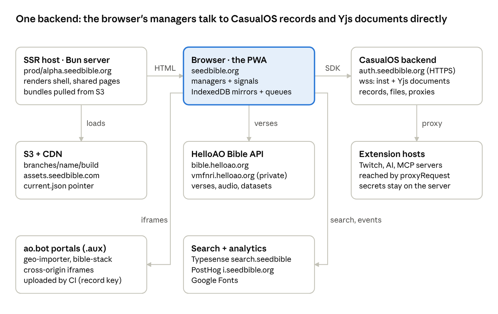
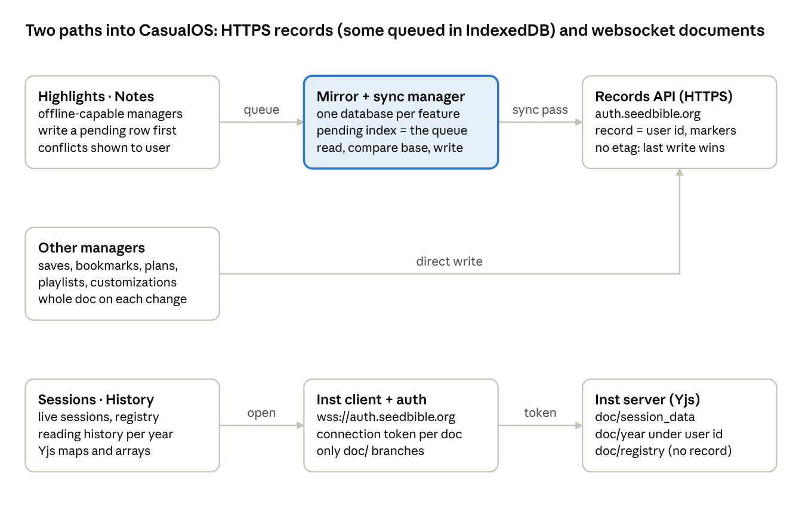

# Seed Bible Reader: Old Architecture (CasualOS era)

As of 2026-10-22 · Richard Pedersen

> Exported from the Claude Doc written on 2026-10-22; keep both in step. Live, commentable copy: https://claude.ai/artifact/4wmdAEZ9aJF6S3bZznK1Dh

## What this document covers

This is the reference for the reader as it runs today at seedbible.org: the Preact app in `packages/seed-bible`, with CasualOS (auth.seedbible.org) as its only backend. It records what each part did, where every kind of data lived, and which outside services were called, so that the companion [Seed Bible Reader: New Architecture (A2A and MCP era)](./new-architecture-a2a-mcp.md) can say what moved, what stayed, and where each thing is now.

"Old" does not mean retired. seedbible.org keeps running on this architecture; the new reader at seed-reader.faithnet.io is a parallel build and nothing here is to be cut over or changed. Read this document first, then the new one; the new one ends with an old-to-new mapping table that points back to the sections here.

Everything below was read from the code on branch `feature/seed-bible-ap` on 2026-10-22, with file paths given so a reader can open the source.

## The big picture

The old reader has one backend, CasualOS at auth.seedbible.org, and the browser talks to it directly through the CasualOS SDK. Every manager that needs persistence goes through one gateway object, `OsManager`, which wraps three SDK clients: the records client (HTTPS procedures for data, files, auth, permissions and proxies), the inst client (a websocket carrying Yjs shared documents), and an auth source that mints connection tokens for those documents. There is no application server of our own in the data path; the only server we run is the SSR host, and it reads CasualOS anonymously.

Read it from the centre: the browser is where all the logic lives. It pulls verses from the Bible API, writes and reads every record over the CasualOS SDK, and keeps IndexedDB mirrors for the three features that work offline. The SSR host only serves HTML and reads CasualOS and the Bible API anonymously for shared pages. Extension secrets are reached through CasualOS proxy records, so the browser never holds a key for an outside host. The .aux patterns run in separate ao.bot iframes with their own CasualOS runtime.

| Part | Where | Role |
| --- | --- | --- |
| The PWA | `packages/seed-bible/seed-bible`, served at seedbible.org | Preact app with signals. Around sixty managers under `managers/` own the business logic; components render their signals. Installable, with a service worker on main. |
| OsManager | `managers/OsManager.tsx` | The only CasualOS gateway. Records client on `https://auth.seedbible.org`, inst websocket on `wss://auth.seedbible.org`, one random connection id per page load. |
| CasualOS | auth.seedbible.org (records server, auth server, inst server, file bucket) | Email-code login and sessions; data records keyed by record name and address with markers; file records uploaded to presigned S3 URLs; Yjs shared documents on branches; shared-permission grants; proxy records that forward requests to outside hosts with stored secrets; server-side link previews. |
| SSR host | `server/index.ts`, Bun, `Dockerfile`; prod.seedbible.org and alpha.seedbible.org | Renders the app shell and shared playlist, plan and customization pages per branch and build, loading bundles from S3 and caching them in worker threads. |
| S3 and CDN | bucket `branches/<name>/<build>/`, assets at assets.seedbible.com | Client and server bundles per branch and commit, a `current.json` pointer per branch, PWA shell at the bucket root for main. |
| Bible API | bible.helloao.org (free), vmfnri.helloao.org (private default) | Translations, books, chapters, audio links, cross-reference and theographic datasets. Called by the browser and by the SSR host. |
| Search and analytics | search.seedbible.org (Typesense), i.seedbible.org (PostHog ingest) | Verse search with a browser-side search key; feature flags and events through PostHog. |
| Extensions and patterns | `packages/*-extension`, `patterns/*.aux` | Extensions run inside the PWA and call outside hosts through CasualOS proxy records. Patterns are CasualOS bot scripts packaged to .aux by CI and shown in cross-origin ao.bot iframes. |

## How the reader talks to CasualOS

All CasualOS access goes through one object, `CasualOSManager` in `managers/OsManager.tsx`, created once in `SeedBibleStateManager` with the default endpoint and handed to every manager that persists anything. It holds the session key and connection key as signals, wraps the SDK's records client in a guard that notices a dead session, and lazily builds the websocket client the first time a shared document is asked for.

**The SDK pin.** `@casual-simulation/aux-common`, `aux-records`, `aux-runtime` and `aux-vm` at `4.2.8-alpha.38630400059`, with a local patch to `aux-records` that widens the session-validation error type. The proxy-record procedures are newer than this SDK, so the app declares their types itself and relies on the client forwarding any method name to the server.

**Three clients**

| Client | Built where | Purpose |
| --- | --- | --- |
| Records client | `createRecordsClient("https://auth.seedbible.org")`, then wrapped by `guardRecordsClient` | Every HTTPS procedure: data, files, login, sessions, user info, shared permissions, proxies, link previews. The app's `sessionKey` signal is mirrored onto `client.sessionKey` by an effect so every call carries it. |
| Inst client | `getInstClient()`: `wss://auth.seedbible.org` through WebsocketManager, WebsocketConnectionClient, AuthenticatedConnectionClient, InstRecordsClient | Yjs shared documents for live sessions, the sessions registry and reading history. Created only when first needed, so Yjs is not loaded for readers who never use multiplayer. |
| Auth source | `getAuthSource()`: a PartitionAuthSource answering the inst client's auth messages | When the server asks for an indicator it answers with a V1 connection token minted from the connection key for the record and inst, or with the bare connection id when signed out. It refuses to mint a token for any branch that does not start with `doc/`, which keeps the app from loading real inst data by accident. The default inst when none is named is `seed-bible`. |

**What the gateway exposes and the SDK call behind each**

| Function | SDK call | Notes |
| --- | --- | --- |
| `getData(recordName, address)` | `getData` | Results are interpreted by `RecordRead.ts`: `data_not_found` means absent, anything else means error, so a flaky read never looks like a new user. |
| `recordData(recordKey, address, data, {marker})` | `recordData` with one marker | A blind overwrite; CasualOS has no etag or compare-and-set. Every write is also logged to the console. |
| `eraseData`, `eraseFile` | same names |  |
| `listDataByMarker`, `listAllDataByMarker` | `listData` with a marker, paged by last address | Used for per-chapter and per-kind listings. |
| `listAllData(recordName)` | `listData` with no marker, every page | One sweep of the whole record. Concurrent sweeps of the same record share one promise. Exists because annotations are marked per chapter, so listing by marker would take over a thousand requests. |
| `recordFile(recordKey, data, {mimeType, marker})` | `recordFile` then a PUT to the returned upload URL | Bytes are hashed with sha256 first; `file_already_exists` reuses the existing URL. Default marker `publicRead`. |
| `getSharedDocument(recordName, inst, docName, {markers, timeoutMs})` | dynamic import of `RemoteYjsSharedDocument`, branch `doc/<docName>`, `connect()`, then wait for sync | Without a timeout an expired session or dropped connection waits forever, since neither errors; callers that can carry on pass a timeout and the document is released on failure. |
| `clearBranchDeviceCache` | deletes one key from the inst client's private device map | A workaround for an SDK presence bug after reconnect. |
| `recordProxy`, `eraseProxy`, `proxyRequest` | server procedures of the same names | A proxy record holds a host and secret data on the server; `proxyRequest` makes the server call that host. The browser never sees the secret. |
| `requestSharedPermission`, `acceptSharedPermission`, `rejectSharedPermission`, `revokeSharedPermission`, and the three listings | same names, listings paged by number | The friends mechanism. A request must name a target user or email. |
| `getLinkPreview(url, locale)` | `getLinkPreview` | Server-side fetch, memoised per page load. |
| `requestWakeLock`, `disableWakeLock`, `promptToInstallPWA` | browser APIs | Not CasualOS; kept here because they are device concerns. |

**The session guard** (`managers/SessionGuard.ts`). Every call through the guarded client is inspected on the way back. Three error codes mean the session is dead: `session_expired`, `invalid_key`, `user_is_banned`. On one of those the guard fires `sessionInvalidated` once per key, and `LoginManager` clears the local session and opens the login modal. Codes like `server_error`, `rate_limit_exceeded`, `not_authorized` and `not_logged_in` are deliberately not fatal. `revokeSession` is ignored because sign-out itself often returns `session_expired`.

**Record naming convention.** Every manager uses the signed-in user's id as the record name and as the record key argument. There is one record per user; kinds of data are told apart only by address and marker. Almost everything carries a `publicRead` marker or a `publicRead:<kind>` marker, which is what lets friends' content be read without any sharing step. The one private thing is extension secrets.

## Sign-in, sessions and the profile

Sign-in is an email code at CasualOS, and the session key it returns is kept in localStorage for the life of the session. `managers/LoginManager.tsx` owns the flow; `OsManager` only holds the keys.

**The login flow**

1. At construction the manager reads `sessionKey` and `connectionKey` from localStorage, sets them on `OsManager` and the records client, and schedules a refresh for one week before the key's expiry. An unparsable key forces sign-out.
2. If a key exists, `getUserInfo({userId})` loads `{id, email}` in the background.
3. `login()` opens the modal and returns a promise that resolves with the user or null on dismissal.
4. The modal calls `requestLogin({ address: email, addressType: "email", comId: "seed-bible" })`. CasualOS emails the code.
5. `completeLogin({ code, requestId, userId })` returns the session key and connection key. Both are written to localStorage by an effect, and the profile loads.
6. `replaceSession()` refreshes the key on schedule; failure keeps the old key and lets the guard decide.
7. Sign-out calls `revokeSession` (errors ignored), then clears the keys, the profile caches and the user info. A forced sign-out from the guard skips the revoke, clears the same state, records a reason (`signed_out` or `account_suspended`) and reopens the modal with a toast.

**The profile record.** Record name is the user id, address `profile`, marker `publicRead`. Fields are name, location, picture URL, description and a free-form `config` object. That `config` object is where settings live: translation, language, theme, installed extensions and the rest are keys inside it, and every setting change is one `recordData` of the whole profile. Reading it uses `data_not_found` to mean a brand-new account; any other failure throws rather than falling back to a blank profile, because the next merge-write would otherwise wipe the account. On first load of a new account, any settings the device collected while signed out are adopted into the profile. Profile pictures are file records with `publicRead`.

**What is stored where**

| Key | Where | Content |
| --- | --- | --- |
| `sessionKey` | localStorage | the raw CasualOS session key |
| `connectionKey` | localStorage | the raw connection key, used to mint connection tokens for shared documents |
| `sb-profile-cache-<userId>` | localStorage | last confirmed profile, shown while the real one loads |
| `sb-profile-config-local` | localStorage | the signed-out settings bag, up to 100 keys, adopted on first sign-in |
| `profile` | CasualOS data record under the user id | name, picture, bio, and `config` with every setting |

**Analytics tie-in.** When the user id changes the manager calls `posthog.identify(userId)`, so PostHog sessions are keyed by CasualOS user id.

**Anonymous use.** Everything reads fine signed out: the app uses the bare connection id for shared documents, keeps highlights and notes under a local owner in IndexedDB, and offers to adopt them into the account at sign-in.

## Bible content and reading position

Verse text never touches CasualOS. It comes from a HelloAO-style Bible JSON API, read with plain GETs and no credential, cached in memory per page load and in IndexedDB for downloaded translations.

**Endpoints** (`managers/FreeUseBibleAPI.tsx`). Two hosts are hard-coded: the private mirror vmfnri.helloao.org is the default, and the public bible.helloao.org is used only when the page URL carries `?useFreeBibleAPI`. One API object is created in `SeedBibleStateManager` so the SSR host and the client use the same host.

| Data | Path under the endpoint |
| --- | --- |
| Translation catalogue, with a content hash and licence per translation | `api/available_translations.json` |
| Books of a translation | `api/<translation>/books.json` |
| One chapter | `api/<translation>/<book>/<chapter>.json` |
| A whole translation in one file, about 7 MB | `api/<translation>/complete.json` |
| Per-verse audio timings | a link in the chapter response, for example `/api/AAB/GEN/1.david.audioTimings.json` |
| Chapter audio | the chapter response's `thisChapterAudioLinks` map; the MP3 hosts are whatever the API returns |
| Cross-reference and theographic datasets | `api/d/open-cross-ref/...` and `api/d/theographic/...` on the same host, used by extensions |

**Caching layers.** The API keeps one promise per URL for the page's life, and the SSR host snapshots that cache into the page so the client does not refetch the first chapter. `BibleDataManager` keeps a localStorage copy of the catalogue and an endpoint map per translation, and reads offline first. Downloaded translations live in IndexedDB database `seed-bible-offline` with stores `translations` and `chapters` keyed `translationId/bookId/chapterNumber`; staleness is detected by comparing the stored content hash with the live catalogue. The service worker does not cache the Bible API at all; offline text comes from IndexedDB.

**Audio and speech.** `AudioPlaybackManager` is only a registry of controllers per tab; the audio-reader extension supplies the `<audio>` element and verse highlighting from the timings file. Text to speech is the browser's own `speechSynthesis`, with no outside voice service.

**Reading position is not a record.** `BibleReadingManager` persists nothing itself. The open tabs and the chapter in each live in localStorage under `sb-tabs-state` through `TabsPersistence`, and never sync. The selected translation is one key in the profile record's `config`. The resume card on Today is derived from reading history, with a localStorage hint `sb-today-history-<userId>` that says whether history exists. There is no manifest or index of what the user has.

## User data: highlights, notes, saves, bookmarks, history and the rest

Every kind of user data is a CasualOS data record under the user's own id, told apart by address and marker, and nearly all of it is world-readable. Three features (highlights, notes, reading history) have an IndexedDB mirror and a sync pass so they work offline; everything else is written through to the server as a whole document on every change. There is no outbox shared across features, no bucket manifest and no Library index in this package; those exist only in the new reader.

**The shared offline layer** (`managers/OfflineRecordStore.ts`, `managers/RecordSyncManager.tsx`). One IndexedDB database per feature, with a `records` store keyed `<owner>/<address>` and a `pending` index on `[owner, pendingOp]`. Because IndexedDB cannot index null, a row whose `pendingOp` is cleared drops out of that index, so the index is the queue. Each row carries the payload, a `base` copy of the server version the edit was built on, a tombstone flag and an attempt count (five tries at most). The sync pass is read-then-write: `getData`, compare with `base`, then `recordData` or `eraseData` with the feature's marker. If the server copy moved, the feature's merge runs when it has one (highlights do, per verse); otherwise the user is asked to keep mine, keep theirs or keep both. A thrown network error or a dead session stops the pass and leaves rows pending. Signed-out rows belong to owner `local` and are offered for adoption at sign-in. Retryable server codes are `server_error`, `rate_limit_exceeded` and `not_logged_in`.

| Feature | Address under the user's record | Marker | How it is written | Offline |
| --- | --- | --- | --- | --- |
| Highlights | `highlights:<translationId>/<bookId>/<chapter>`, one record per chapter holding every verse colour | `publicRead:highlights/<translationId>` | pending row in IndexedDB `seed-bible-highlights`, then the sync pass; three-way per-verse merge on conflict | yes |
| Notes (annotations) | `annotation_<uuid>`, one record per note with the author's name and picture copied in; replies and tags inside | `publicRead:annotations/<bookId>/<chapter>` | pending row in `seed-bible-annotations`, then the sync pass; `updatedAtMs` as the version; keep-both duplicates with a new id. A `?annotationRecordKey=` URL parameter can point every note at a shared team record, written directly | yes |
| Saves and categories | `saves` (legacy `bookmarks` copied forward once) | `publicRead` | one `recordData` of the whole document per change | no |
| Chapter bookmarks, up to five | `readingBookmarks` | `publicRead` | whole list per change | no |
| Reading history | not a record: one Yjs shared document per year, record name the user id, inst `reading_history`, branch `doc/<year>`, array `events` of `{userId, bookId, chapter, start, end}` | `publicRead:reading_history/<year>` | a 5-second ticker writes spans; IndexedDB `seed-bible-reading-history` holds pending rows and replays them per year, with no attempt cap | yes |
| Playlists | `playlist_<uuid>` on the author's record; share locator `<recordName>.<id>` | `publicRead:playlists` | whole document per change; play history as `playlist_history_<uuid>` with `publicRead:playlistPlayHistory`, newest 200 kept | no |
| Reading plans | `plan_<uuid>` plus a `plan_<uuid>_metadata` companion so lists render without bodies; progress at a uuid on the reader's record with `planId` `rp_<recordName>_<address>` | `publicRead:readingPlan`, `publicRead:readingPlanMetadata`, `publicRead:readingPlanProgress` | whole document per change | no |
| Customizations (church themes) | `customization_<uuid>`; logo as a file; opened by `?customization=<recordName>.<id>` | `publicRead:seedBibleCustomization` | whole document per change; the SSR host pre-reads it | no |
| Variant and extension choices per customization | `customizationVariantSelections`, `customizationExtensionPreferences` | `publicRead` | whole object per change; signed-out choices in the local config bag | no |
| Gallery photos | file record plus `photo_<uuid>` | `publicRead` on the file, `publicRead:userGallery` on the record | upload then record; newest 24 cached in localStorage | no |
| Extension settings | `extensionSettingValues` | `publicRead` | debounced 700 ms, whole object | no |
| Extension secrets | pointer record `extensionSensitiveProxies` with marker `private`; the secret itself in a proxy record at a uuid address | `private` | `recordProxy`; requests go through `proxyRequest` so the server calls the outside host | no |
| MCP server configs (extension) | `mcp-servers` | private default | whole object | no |
| Friends | not a record: a two-way shared permission `{marker: "friends", resourceKind: "data", action: "read"}` requested for seven days | n/a | `requestSharedPermission` and accept; lists rebuilt from the three permission listings every 30 seconds on focus | no |
| Settings | keys inside the profile record's `config` | `publicRead` | one `recordData` of the whole profile per change; URL overrides and the local config bag when signed out | no |

**How friends' content is read.** Nothing gates reads on the friends permission. Friends' highlights, notes, history, playlists and plan progress are read straight from their records because every marker is `publicRead` or `publicRead:<kind>`. `FriendsManager` is therefore a social-graph signal, not an access grant. Friend reads go through a limiter (stale after 30 seconds, four in flight, 20-second timeout).

**"All my X" is a full sweep.** Your Content and the Today notes feed call `listAllData(userId)`, which pages through every address in the record with no marker, because highlights are marked per translation and notes per chapter. Today does this once per friend and caches for five minutes.

**Addressing and conflicts.** No write is conditional. CasualOS has no etag or compare-and-set, so the sync layer's read-then-write is the only guard against clobbering, and the write-through features have none.

## Shared sessions and multiplayer

A live session is one Yjs shared document on the CasualOS inst server with no record behind it: record name null, inst equal to the session id, branch `doc/session_data`. Anyone with the id can join; a signed-in user connects with a connection token, a visitor with the bare connection id.

**Opening a session** (`managers/SessionsManager.tsx`). The id is `session-<uuid>` and the join URL is `?sessionId=<id>`, read at boot and never during SSR. `createSession` claims `hostUserId` (the user id, or the connection id when signed out) and seeds the options in one transaction; `joinSession` passes no defaults. `getSharedDocument` is called with no timeout here, so a session open waits as long as the connection does.

**What is inside the document**

| Yjs map | Content |
| --- | --- |
| `reading_state` | translation, book, chapter, scroll-to verse |
| `options` | allowed navigators and decorators, host and co-host user ids, highlight duration, ended time, whether the translation is shared, verse-selection effect visibility |
| `decorations` | keyed by `[connectionId, decorationId]`, the temporary verse decorations |
| `reading_extensions` | extension id to enabled flag and data, so extensions can sync their own state |
| `user_profiles` | connection id to user id, profile and joined time, the live identity broadcast |
| `reading_positions` | connection id to the book, chapter and visible verse range |
| `chats` (array), `chat_providers`, `chat_participant_aliases`, `chat_typing` | shared chat messages (text and tool calls, deduplicated by id), which AI participants each person added, old-to-new participant id after a mid-session sign-in, typing flags |

**Roles.** Hosts and co-hosts can always navigate and decorate; an empty allow-list means everyone may. Navigation publishes are debounced 150 ms and scroll ranges 500 ms; remote positions apply through a single drain queue.

**Presence.** The document's remote client list, merged with `user_profiles`, with a fallback to the public profile record. After a reconnect the manager clears the inst client's device cache (an SDK workaround) and rebuilds the subscription. Each participant gets a deterministic animal icon and colour from a hash of their id.

**Invitations are a second document.** There is no invite record or share code. `InvitationsManager` opens one global document, inst `shared-sessions-registry`, branch `doc/registry`, with a `sessions` map of session id to host user id, host connection id and published time. It is opened only when signed in with at least one friend, and clients show only sessions hosted by a friend whose connection is still live. Publishing is the invite; joining is the acceptance.

**Chat** (`managers/ChatsManager.tsx`) takes no `os` at all; it rides on the session document's arrays and maps above. AI providers are supplied by extensions and the list of AI participants is synced so everyone sees who was added.

**Leaving.** `dispose` flushes pending publishes, removes the user's own `user_profiles` and `reading_positions` entries and unsubscribes the document. Nothing about a session survives on the server beyond the Yjs branch itself; there is no session record.

## Search

Verse search is one query from the browser to a Typesense server at search.seedbible.org, read-only, with a search key that ships in the client bundle.

- **Collections** are `bibleVerses.<language>`, one per Bible language. Each document is `{id, translation, book, chapter, verse, text, language, reference}`.
- **The query** (`managers/SearchManager.tsx`) searches `referenceNormalized`, `reference` and `text`, filters by translation and optionally book and chapter, and maps each hit straight to a verse. The Typesense client is imported on the first search. During SSR search returns an empty result.
- **The key** is the constant `TYPESENSE_API_KEY` in the manager, so it has to be a search-only key.
- **Who builds the index** is not in this repository; no indexing script exists here.
- `translationSearch.ts` is unrelated to Typesense: an in-memory search over the loaded translation catalogue, exposed as an AI function tool so a chat model can look translations up.

## Extensions, AI providers and the .aux patterns

Extensions run inside the PWA as code-split chunks of the same build; nothing runs as a CasualOS bot script except the three 3D patterns, which live in ao.bot iframes. AI models are reached only through extensions, never by the core app.

**How an extension loads** (`managers/ExtensionManager.tsx`). A Vite plugin reads every `packages/<folder>/extension.json` into a virtual module whose entries are dynamic imports, so an extension is fetched only when installed. Each module's default export calls `registerExtension({ id, init })`; `init(context)` is a generator that yields cleanup functions, and the manager calls the default export on every install so an extension can be removed and re-added in one session. Installed ids are kept in localStorage and in the profile record's `config`. A `loadExtensionFromUrl` path exists for a raw URL import but nothing in the repo uses it. Non-secret settings go to the `extensionSettingValues` record; secret settings go to a CasualOS proxy record and are used through `proxyRequest`, so the server injects the key and calls the outside host.

| Extension | What it does | Outside hosts | Direction and credential |
| --- | --- | --- | --- |
| audio-reader (auto-installed) | Plays chapter narration and highlights verses from the timings file | the MP3 hosts the Bible API names | read, none |
| compare (auto-installed) | Side-by-side translations from `BibleDataManager` | none |  |
| references | Cross-references pane; optional full download into IndexedDB `seed-bible-references` | `vmfnri.helloao.org/api/d/open-cross-ref/...` | read, none |
| theographic (needs locations) | People, places and events per chapter, cached in IndexedDB `seed-bible-theographic` | `<bibleApiEndpoint>/api/d/theographic/...` | read, none |
| locations | Finds place names in selected verses and opens a map | GeoJSON from raw.githubusercontent.com (openbibleinfo Bible-Geocoding-Data, Bored-Wizard isreal\_geojson); the map is the geo-importer pattern in an ao.bot iframe | read, none |
| default-content | Discover providers: a curated YouTube list and BibleProject videos from bundled JSON | youtube.com, i.ytimg.com, bibleproject.com, imagekit, cloudfront, mux as embeds | read, none |
| apologist | An AI chat provider with tool calling and shared-chat support, plus a Discover provider | apologist.seedbible.io chat completions, search and shares; default model `openai/gpt/5-mini` | write (chat). Key from `?apologistApiKey=` as `x-api-key`, or saved as a sensitive setting and sent through the CasualOS proxy |
| bonfire | An AI chat provider | bonfire.seedbible.io session start, chat, end | write (chat). No key; org and AI ids hard-coded or from URL |
| mcp | Lets the user add remote MCP servers whose tools feed every AI chat; StreamableHTTP with an SSE fallback | any user-entered `https://.../mcp` | read and write to the user's own servers; optional headers in the private `mcp-servers` record |
| transcript and transcript-ui | Live or file transcription and scripture-reference inference | an ephemeral OpenAI key from aolab-bible-api.netlify.app, then `wss://api.openai.com/v1/realtime`; ffmpeg.wasm from cdn.jsdelivr.net; inference through the CasualOS `aiChat` procedure | write (audio to OpenAI) with a short-lived key |
| twitchPub (needs transcript) | Streamer side: device-code OAuth, posts the current chapter and highlights into Twitch chat as base64 JSON, reads chat over EventSub | id.twitch.tv, api.twitch.tv helix, `wss://eventsub.wss.twitch.tv` | write (chat messages, announcements, subscriptions). Client id and channel id hard-coded; user token in localStorage |
| twitchSub | Viewer side: implicit-grant OAuth, follows the streamer's reader state from chat | same Twitch hosts | read chat, write EventSub subscriptions |
| refresh-example | The reference template with a settings and sensitive-proxy demo | httpbin.org through the proxy | demo |

**AI in the core.** `AIManager` defines only types and schemas for function tools and playlist generation. `ChatsManager` defines the provider interface (`generateResponse`, shared-chat and tool-calling flags) and `registerProvider`. Shared chats ride on the session document. The core calls no model endpoint of its own.

**The .aux patterns** (`patterns/bible-stack`, `patterns/house-of-the-lord`, `patterns/geo-importer`). These are CasualOS bot scripts. `PortalComponent` renders an iframe to `https://ao.bot/?inst=<uuid>&gridPortal|mapPortal=...&pattern=<name>` (or `&patternAux=<url>` in dev), and postMessage in both directions is restricted to the ao.bot origin. The patterns talk back with `os.sendEmbedMessage` and make no record or fetch calls of their own; bible-stack and house-of-the-lord load sounds, images and 3D assets from two CasualOS file buckets on S3, and geo-importer loads an opentype.js bundle from esm.helloao.org. Packaging is in `script/lib/vite-plugin-patterns.ts`: dev serves a freshly packaged .aux at `localhost:3002/@pattern-aux/<folder>.aux`; build runs `casualos pack-aux`, `minify-aux` and `check-aux`, names the result `<folder>-<shortHash>`, and when `PATTERN_SESSION_KEY` and `PATTERN_RECORD_KEY` are set uploads it with `recordFile` (marker `publicRead`) into the `aoBot` record and writes a data record, so ao.bot loads it by name. `packages/scripture-map` is not a pattern; it is a plain Preact grid registered as a below-reader tool.

**Hard-coded identifiers worth knowing.** The Typesense search key, the PostHog project key, the Twitch client and channel ids, and the Bonfire org and AI ids all sit in source.

## Flows inside CasualOS

A record read or write travels one of two paths: an HTTPS procedure on the records server, or a Yjs document over the inst websocket. The records path is where almost all data goes, and only highlights and notes pass through the IndexedDB queue on the way; everything else is a direct overwrite.

The top row is the queued path, the middle row the direct path into the same records API, and the bottom row the document path. Reading history uses the document path with an IndexedDB queue of its own in front of it.

**A record write, step by step**

1. The manager builds the payload and names the address and marker. The record name and record key are both the user's id.
2. Queued features (highlights, notes): the row is written to IndexedDB with `pendingOp` set and `base` holding the last server copy; `notifyLocalChange` wakes the sync manager. Direct features skip to step 4.
3. The sync pass runs: `getData` for the address, compare with `base`, then `recordData` or `eraseData`. A changed server copy triggers the feature's merge or a user conflict. Five attempts, then the row is left as is.
4. The records server checks the session key, resolves the record by name, applies the marker's policy, and stores the item. There is no version check on the server; the newest write replaces the old.
5. The reply is `{success}` or `{success: false, errorCode}`. The guard watches for a dead session; the sync manager classes the code as retryable or permanent.

**A record read.** `getData` for one address, `listData` with a marker for a chapter's notes or a kind of record, or `listData` with no marker to sweep the whole record. Reads of friends' records use the same calls with the friend's id; they succeed because of the public markers.

**A file.** `recordFile` with the sha256 and byte length returns an upload URL and method; the browser PUTs the bytes there (an S3 bucket behind CasualOS), minus a list of unsafe headers. The file URL is then stored in a data record. `file_already_exists` returns the existing URL.

**A shared document, step by step**

1. `getSharedDocument(recordName, inst, docName)` builds a RemoteYjsSharedDocument on branch `doc/<docName>` and connects. The inst websocket is created on first use.
2. The server asks for an indicator. The auth source answers with a V1 connection token minted from the connection key for that record and inst, or with the bare connection id when signed out. If the server later says `not_authorized` with `invalid_token`, a token is minted for the named record and inst, but only when the branch starts with `doc/`.
3. The document syncs; the manager waits for `synced: true`, with a timeout where the caller can carry on without the document (reading history uses 10 seconds; sessions use none).
4. Reads and writes are Yjs transactions on maps and arrays; the server relays updates to every connected client and keeps the branch.
5. `unsubscribe` closes the branch for this client. The branch persists on the server.

**Permissions and markers.** A marker is a label on an item that a policy on the record grants rights to. `publicRead` and `publicRead:<kind>` let anyone read. `private` lets only the owner. The `friends` marker exists only as the target of a shared-permission grant and is never put on an item, so friends read through the public markers. A shared permission is requested with `requestSharedPermission` against a target user or email, accepted or rejected by that person, and expires.

**Proxies.** `recordProxy` stores a host, a request mapping and secret data on the server under a uuid address with a `private` or `publicRead` marker (public only grants running it). `proxyRequest` names the record, address, path, method and body; the server injects the secret and calls the host, and returns status, headers and body. The browser never sees the secret.

**Sessions and the guard.** Every HTTPS call carries the session key. Three error codes end the session; others are left to the caller. The connection key is only used to mint document tokens and is refreshed with the session key by `replaceSession`.

## External integrations

The browser reaches many hosts on its own. Most are read-only public data; the writes are CasualOS, PostHog, the AI chat providers, OpenAI transcription, Twitch, and user-entered MCP servers.

| Host | Purpose | Direction | Credential and where it lives | Called from |
| --- | --- | --- | --- | --- |
| auth.seedbible.org (HTTPS and wss) | CasualOS: login, records, files, Yjs documents, link previews, proxy records, the `aiChat` procedure; pattern uploads from CI | read and write | the user's session key in localStorage; CI secrets `SESSION_KEY` and `RECORD_KEY` | `OsManager.tsx`, `script/lib/pattern.ts`, `cd.yml` |
| vmfnri.helloao.org (default), bible.helloao.org (`?useFreeBibleAPI`) | Bible catalogue, books, chapters, complete files, audio timings, cross-reference and theographic datasets | read | none | `FreeUseBibleAPI.tsx`, references and theographic extensions, SSR |
| Chapter audio hosts named by the API | MP3 narration | read | none | audio-reader extension |
| search.seedbible.org | Typesense verse search | read | search key in source | `SearchManager.tsx` |
| i.seedbible.org, us.posthog.com | PostHog events and feature flags | write | project key in source | `app/initPostHog.tsx`, `FeaturesManager.tsx` |
| assets.seedbible.com | CDN for hashed build assets; the SSR host proxies to it | read; CI writes by AWS OIDC role | `ASSET_BASE_URL`, `DEPLOY_BUCKET` | `vite.config.ts`, `server/index.ts`, `cd.yml` |
| prod.seedbible.org, alpha.seedbible.org | The SSR hosts and their `/__invalidate` endpoint | CI writes | `INVALIDATION_SECRET` | `cd.yml`, `server/index.ts` |
| ao.bot, favicon.ao.bot | Iframe host for the .aux patterns; PWA icons and screenshots | read plus postMessage | none | `PortalComponent.tsx`, `vite.config.ts` |
| Two CasualOS file buckets on S3, esm.helloao.org | Sounds, images, 3D assets and a vendor bundle for the patterns | read | none | `patterns/*` |
| fonts.googleapis.com, fonts.gstatic.com (Fontshare allowed in the service worker) | Web fonts and Material Symbols | read | none | `app/main.tsx`, `standalone/sw.ts` |
| flagcdn.com, res.cloudinary.com | Language flags; two logo images | read | none | `SettingsPage.tsx`, `icons.tsx` |
| youtube.com, i.ytimg.com, player.vimeo.com, bibleproject.com, imagekit, cloudfront, mux | Embedded videos and posters in playlists and Discover | read | none | `resolveLinkMedia.ts`, default-content extension |
| raw.githubusercontent.com | Place GeoJSON (openbibleinfo, Bored-Wizard) | read | none | locations extension |
| apologist.seedbible.io | Apologist AI chat, search and shares | write | `x-api-key` from a URL parameter or a CasualOS sensitive proxy | apologist extension |
| bonfire.seedbible.io | Bonfire AI sessions | write | none; org and AI ids in source | bonfire extension |
| aolab-bible-api.netlify.app, wss://api.openai.com/v1/realtime, cdn.jsdelivr.net | Ephemeral transcription key, live transcription, ffmpeg.wasm | write (audio) | short-lived key per session | transcript extension |
| id.twitch.tv, api.twitch.tv, wss://eventsub.wss.twitch.tv | Twitch OAuth, chat send and announce, EventSub | read and write | client id and channel id in source; user tokens in localStorage | twitchPub and twitchSub extensions |
| User-entered MCP servers | AI tools over StreamableHTTP or SSE | read and write | optional headers in the private `mcp-servers` record | mcp extension |
| httpbin.org | The example extension's proxy demo | write | through a sensitive proxy | refresh-example extension |
| api.telegram.org | Build and deploy notices | write | `TELEGRAM_BOT_TOKEN`, `TELEGRAM_CHAT_ID` secrets | `script/lib/telegram.ts` |
| auth.ao.bot, api.ao.bot | Dev scripts only: link previews for the Discover list, the casualos-cli session | read | casualos-cli session | `script/lib/*` |
| An OTLP collector | Server traces and metrics | write | `OTEL_EXPORTER_OTLP_ENDPOINT` | `server/telemetry.ts` |
| better.giving, discord.com, github.com | Outbound links only |  |  | About page |

## Data inventory

One row per kind of stored data. Record name is the user's id unless stated. Storage type says whether the thing is a CasualOS data record, a file record, a Yjs shared document, or local to the browser.

| Data | Record name | Address or branch | Marker | Storage type | Read by whom |
| --- | --- | --- | --- | --- | --- |
| Session and connection keys |  | localStorage `sessionKey`, `connectionKey` |  | local | this browser |
| Profile, settings in `config` | user id | `profile`; picture as a file | `publicRead` | data record plus file; localStorage `sb-profile-cache-<userId>`, `sb-profile-config-local` when signed out | owner, anyone |
| Chapter highlights | user id | `highlights:<translationId>/<bookId>/<chapter>` | `publicRead:highlights/<translationId>` | data record plus IndexedDB `seed-bible-highlights` | owner, friends, Your Content by full sweep |
| Notes | user id or `?annotationRecordKey` | `annotation_<uuid>` | `publicRead:annotations/<bookId>/<chapter>` | data record plus IndexedDB `seed-bible-annotations` | owner, friends by marker, Today and Your Content by full sweep |
| Saves and categories | user id | `saves` (legacy `bookmarks`) | `publicRead` | data record | owner |
| Chapter bookmarks | user id | `readingBookmarks` | `publicRead` | data record | owner |
| Reading history | user id | inst `reading_history`, branch `doc/<year>`, array `events` | `publicRead:reading_history/<year>` | Yjs document per year plus IndexedDB `seed-bible-reading-history` | owner, friends, Today |
| Open tabs and positions |  | localStorage `sb-tabs-state` |  | local | this browser |
| Playlists | author id | `playlist_<uuid>` | `publicRead:playlists` | data record | owner, anyone with the locator, friends |
| Playlist play history | viewer id | `playlist_history_<uuid>` | `publicRead:playlistPlayHistory` | data record | owner |
| Reading plan and its metadata | author id | `plan_<uuid>`, `plan_<uuid>_metadata` | `publicRead:readingPlan`, `publicRead:readingPlanMetadata` | data records | anyone with the locator |
| Reading plan progress | reader id | a uuid; plan id `rp_<recordName>_<address>` | `publicRead:readingPlanProgress` | data record | owner, friends |
| Customization | owner id | `customization_<uuid>`; logo as a file | `publicRead:seedBibleCustomization` | data record plus file | owner, anyone via `?customization=` |
| Variant selections, extension preferences per customization | user id | `customizationVariantSelections`, `customizationExtensionPreferences` | `publicRead` | data records | owner |
| Gallery photo | user id | file plus `photo_<uuid>` | `publicRead`, `publicRead:userGallery` | file plus data record; localStorage `seed-bible:user-gallery:<userId>` | owner |
| Extension settings | user id | `extensionSettingValues` | `publicRead` | data record | owner |
| Extension secret pointers | user id | `extensionSensitiveProxies` | `private` | data record | owner |
| Extension secret values | user id | a uuid proxy record | `private` or `publicRead` (run only) | proxy record on the server | owner, or anyone run-only |
| MCP server configs | user id | `mcp-servers` | private default | data record | owner |
| Installed extensions |  | localStorage `sb-installed-extensions` and profile `config` |  | local plus record | owner |
| Friendships | my record | shared permission `{marker: friends, data, read}` |  | shared-permission grant | both parties through listings |
| Shared-session registry | none | inst `shared-sessions-registry`, branch `doc/registry`, map `sessions` | none | Yjs document | signed-in users with friends |
| Live session content and chat | none | inst `<sessionId>`, branch `doc/session_data` | none | Yjs document | participants |
| Downloaded translations |  | IndexedDB `seed-bible-offline` |  | local | this browser |
| Cross-reference and theographic caches |  | IndexedDB `seed-bible-references`, `seed-bible-theographic` |  | local | this browser |
| Patterns (.aux) | `aoBot` | `<folder>-<shortHash>` as a file and a data record | `publicRead` | file plus data record | ao.bot by name |
| Other local hints |  | localStorage `sb-today-history-<userId>`, `sb-sidebar-collapsed`, `sb-tutorial-*`, `sb-install-dismissed`, `sb-offline-prompt-shown`, `sb-translation-first-used`, `availableTranslations`, `endpoints` |  | local | this browser |

## Build and deploy

The reader deploys as a web app: client, SSR and server bundles go to S3 per branch and commit, and a long-running Bun host serves them. The .aux patterns are packaged by the same build and uploaded to CasualOS when the pattern secrets are set.

**Client boot.** `standalone/index.tsx` imports `app/init.tsx`, which starts PostHog, reads the injected config and the SSR snapshots from `<script>` tags, creates the whole state with `createSeedBibleState` before first paint, waits for i18n and the initial chapters, then either hydrates the server markup or renders fresh. `SeedBibleStateManager.createSeedBibleState` wires every manager in order: features, navigation, the Bible API, i18n, Bible data, then `CasualOSManager()`, login, highlights, saves, bookmarks, friends, settings, chats, annotations, sessions, extension settings and the rest, and finally reads `?sessionId=` to join a session.

**SSR.** `standalone/entry-ssr.tsx` handles redirects, creates a state with the request path, renders, and substitutes placeholders for meta, theme, config, the API snapshot, a customization seed and playlist or plan page seeds. The server reads CasualOS anonymously for a `?customization=` record and for shared playlist and plan pages (plus the author's profile, with a 5-second timeout). Shared documents are never opened on the server.

**The host** (`server/index.ts`, Bun in production, Express plus Vite in dev). Routes: `/` serves the root branch; `/b/<branch>` redirects to the pinned `/b/<branch>/<buildId>`; `?pattern=` redirects to ao.bot; `/healthz`; `POST /__invalidate` guarded by `x-invalidation-secret`. Asset paths are proxied to the asset host. Each build renders in its own worker thread, cached by an LRU; only `ALLOWED_SSR_BRANCHES` get their own bundle. A render failure or timeout serves unrendered HTML and marks it degraded. Telemetry is hand-rolled OpenTelemetry, on only when an OTLP endpoint is set.

| Env var | Meaning |
| --- | --- |
| `PORT`, `ROOT_BRANCH`, `ASSET_HOST` | listen port (3002), the branch for `/`, the upstream for assets |
| `STORE_BACKEND`, `S3_BUCKET`, `STORE_DIR` | s3, local or dev store; the bundle bucket; the local directory |
| `ALLOWED_SSR_BRANCHES`, `DEFAULT_SSR_BRANCH` | which branches render with their own bundle |
| `SSR_WORKERS_MAX`, `SSR_RENDER_TIMEOUT_MS`, `SSR_LOAD_FAILURE_TTL_MS`, `MODULE_CACHE_MAX`, `POINTER_TTL_MS`, `SHUTDOWN_GRACE_MS` | worker and cache tuning |
| `INVALIDATION_SECRET` | the `/__invalidate` secret |
| `SSR_TRANSLATIONS_CACHE_TTL_MS` | the translations list cache, one hour by default |
| `OTEL_EXPORTER_OTLP_ENDPOINT`, `OTEL_SERVICE_NAME`, `OTEL_SDK_DISABLED`, `OTEL_DEBUG_CONSOLE` | telemetry |

**S3 layout** (`server/store.ts`): `branches/<name>/current.json` points at a build id and commit; `branches/<name>/<buildId>/` holds `server.mjs`, `index.html`, `client-manifest.json` and `assets/`. The Dockerfile installs with pnpm on Node, builds with `bun build`, and runs `server/dist/index.js` as the `bun` user on port 3002.

**CI and CD** (`.github/workflows/`). `ci.yml` lints, type-checks, runs coverage, builds and posts a build-size report. `cd.yml` runs on every push: lint, type check, test, then `pnpm build` with `ASSET_BASE_URL`, `DEPLOY_BRANCH`, `DEPLOY_BUILD_ID` (the sha) and the pattern secrets; `aws s3 sync` of assets with immutable caching; on main only, the PWA shell to the bucket root; then the server bundle, manifest and HTML; the `current.json` pointer last; then `POST /__invalidate` on prod (main) or alpha (other branches); a Telegram notice; and a PR comment with the alpha link. Vite's `base` becomes `<ASSET_BASE_URL>branches/<branch>/<build>/`, the service worker is emitted only for main and local, and `__GIT_COMMIT__` is what lets the client trust SSR seeds.

**Patterns in the build.** The `patternPlugin` packs each `patterns/<name>` with `casualos pack-aux`, minifies and checks it, and uploads it with `recordFile` plus `recordData` into the `aoBot` record when `PATTERN_SESSION_KEY` and `PATTERN_RECORD_KEY` are present, so ao.bot can load it by name.

## Pain points that drove the change

The old design works, and seedbible.org keeps running on it. These are the properties of it that the new architecture was built to change; each is observable in the code described above.

- **Everything is public.** Every record except extension secrets carries a `publicRead` marker, because that is the only way friends can see each other's content. The friends permission gates nothing. There is no way to share with some people and not the world.
- **The browser is the only client of the backend.** All business logic, addressing and merging lives in the PWA; a second client or an agent acting for the reader would have to reimplement it.
- **One record, flat addresses, full sweeps.** Highlights are marked per translation and notes per chapter, so "all my notes" is a page-by-page sweep of the whole record, repeated per friend on Today.
- **No conditional writes.** CasualOS has no etag, so the sync layer's read-then-write is the only guard, and the write-through features (saves, bookmarks, plans, playlists, customizations, settings) can clobber another device's change silently. Settings ride inside the profile record, so one settings change rewrites the whole profile.
- **Three different offline designs.** Highlights and notes use one queue, reading history another, and the rest have none, so what survives a lost connection depends on the feature.
- **Identity is an email code at one records server.** There is no portable identity, no delegation, and no way for an organization (a church) to act as itself.
- **Secrets and outbound calls are scattered.** Some keys sit in source (Typesense, PostHog, Twitch, Bonfire), some go through proxy records, and Twitch and the AI extensions write to outside services directly from the browser.
- **Multiplayer has no record.** A session is a nameless Yjs branch; invitations are a second global document; nothing about a session is kept once it ends.
- **The data lives with the operator.** A reader's highlights and notes are rows in Seed Bible's CasualOS record store, not in anything the reader holds or can move.

The companion document shows the answer to each: a Library the person owns, private by default with explicit publishing; a workspace agent that any client can ask; chapter buckets with manifests and opId-idempotent merges; one outbox for everything; the Home as identity with a revocable wire; secrets and outbound calls held to the estate; and a session record that survives the room.
