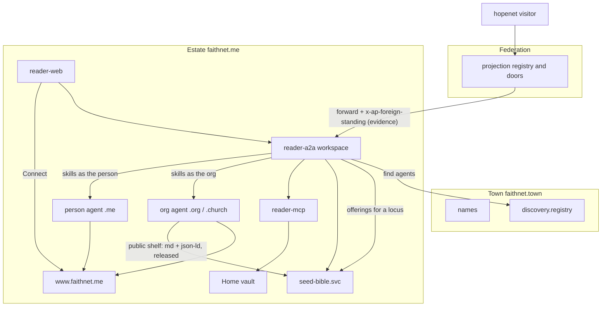

# Overview

Seed Bible is an **estate product** on **faithnet.me**. It is listed in the **faithchain town**. **Federation** admits a visitor from another town. It is not a second CasualOS, and it is not a town service that grants.

The reader you ship is the triad that already exists in this package. We grow those three apps. We do not replace them.

```
reader-web  →  reader-a2a (seed-reader.workspace)  →  reader-mcp
                     │
                     ├─ person agent / org agent at the faithnet.me Home (skills)
                     ├─ Home vault (the record)
                     ├─ seed-bible.svc (serving plane + Seed registry over public shelves, rebuildable)
                     └─ town discovery (find agents only)
```

## Locked: Home and estate

| What           | Value                                        |
| -------------- | -------------------------------------------- |
| Estate         | `faithnet` / `faithnet.estate`               |
| Home           | `https://www.faithnet.me`                    |
| Zone           | `*.faithnet.me`                              |
| Connect client | `seed-bible-reader`, registered at that Home |
| Demo person    | `seedreader.me`                              |
| `ESTATE_IDS`   | `faithnet` only                              |

`*.faithnet.io` is where Workers answer (A2A, vault, edge, Home MCP). That is not another estate. Tokens are accepted only when `iss` is `www.faithnet.me` or a member host under `faithnet.me`. A hopenet visitor would arrive through a federation door with an authority presentation (spec 439 F2), never as a second served estate. That door is not built in this triad yet (see the federation row below and [agents-and-skills.md](./agents-and-skills.md) `seed.workspace.admit`).

## Four scales

| Scale                        | Here                                                                           | Rule                                                                                                                                                                                                                                                                                                                                                                     |
| ---------------------------- | ------------------------------------------------------------------------------ | ------------------------------------------------------------------------------------------------------------------------------------------------------------------------------------------------------------------------------------------------------------------------------------------------------------------------------------------------------------------------ |
| Substrate                    | `@agenticprimitives/*` already in the triad                                    | No Seed Bible vocabulary in those packages                                                                                                                                                                                                                                                                                                                               |
| Estate (`ap-home`)           | faithnet.me Home, vault, runtime, edge, Home MCP; this triad; `seed-bible.svc` | The vault is the record. DOs/D1/R2 serve. Only a person signs, at Home                                                                                                                                                                                                                                                                                                   |
| Town (`ap-town`)             | faithchain naming + `discovery.registry` + public graph                        | A listing is a fact. Nothing in a town grants. The graph holds agent facets, card skills, and released **markdown** shelf passages — never a structured `seed:` descriptor (JSON-LD shelf pages are withdrawn from projection)                                                                                                                                           |
| Federation (`ap-federation`) | ap-federation.faithnet.io; twin with hopenet.town                              | A visitor presents a leaf against hopenet's root read from `EstateProjectionRegistry` on faithchain (`0xb4E1…147b`); admission is evidence, never a grant. Today the only doors are ap-federation's reference doors in front of `alice.me` / `maya-fernandes.me`; reader-a2a has no door yet. A visitor's vault stays on hopenet. MCP stays inside the estate (ADR-0044) |



## The triad (grown in place)

| App          | Today                                                    | Grows into                                                                                                                                                                        |
| ------------ | -------------------------------------------------------- | --------------------------------------------------------------------------------------------------------------------------------------------------------------------------------- |
| `reader-web` | Home connect + hello                                     | Full Seed Bible UI. Calls only reader-a2a. Holds no key                                                                                                                           |
| `reader-a2a` | `hello-reader` skill, `/me`, harness, `streaming: false` | Workspace coordinator. Plans person-agent and org-agent skills. `streaming: true`; relays session and run event streams to the browser over SSE. Never exposes MCP to the browser |
| `reader-mcp` | `hello` tool                                             | Vault tools and domain tools bound to `seed:` IRIs                                                                                                                                |

`seed-bible.svc` (new `seed-bible-a2a` + `seed-bible-mcp`) is the **serving plane**: public file bytes, caches, and the **Seed registry** (the live reading rooms are Durable Objects on `reader-a2a`, the workspace, not here) — a rebuildable D1 index (openbook pattern, `demo-openbook-registry`) built by crawling the public shelves (`library.public.list/read`) of Seed Bible org and person agents, verifying each release, and indexing by `seed:offeredForLocus`. It is not the record and not the identity.

## How a public work becomes findable

The town graph cannot hold a playlist, plan, or customization as data. The path is:

1. The owner (org or person agent) saves the `seed:` JSON-LD descriptor plus a markdown rendering in its own Library (`library.file.save`), marks them public (`library.file.visibility`; the Library knows only `public | private`, see [hard-problems.md §4](./hard-problems.md)), and mints a signed release (`library.file.publish`). These are existing Home skills; Seed publish skills are plans over them.
2. The owner's agent already serves them anonymously via `library.public.list/read` on its `*.faithnet.ai` lane host.
3. The town indexer projects the **markdown** page as one `apcnt:PublishedWork` with passages (semantic search only; no locus filter). Nothing structured.
4. `seed-bible.svc` crawls the JSON-LD descriptors, verifies the release, and indexes by locus. reader-a2a's `seed.workspace.discover` queries this index. Town discovery is used only to find which agents to crawl (`search_agents`, `list_agents_by_context(appContext=seed-bible)`).

## Being listed in the town

Listing `seed-reader.workspace` and `seed-bible.svc` means: charter through the steward's Home, buy the `.workspace` / `.svc` name (priced roots), write name-node records (`a2aEndpoint`, `mcpEndpoint`, `siteUrl`, `displayName`) and the SA profile (`atl:agentType` required or typed resolution fails closed), then `POST /project` or wait for the indexer cron. `town.yaml` gets a `services:` row for the census only; the graph never reads it. The indexer Worker cannot crawl card offerings on a same-account host that is not a declared lane (CF-1042), so either serve the agents' `a2aEndpoint` on a `*.faithnet.ai` lane or declare a lane for the reader-a2a Worker in `town.yaml` and run `gen:town`.

## Who acts

A reader is their **person agent** (`*.me`) at faithnet.me. A church or ministry is their **org agent** (`*.org` or `*.church`). The workspace agent coordinates; it does not become the reader.

Acts are **skills** on those agents, verified by the harness against a live grant. See [agents-and-skills.md](./agents-and-skills.md).

Records are **ontology-shaped**. See [ontology.md](./ontology.md) and [seed.ttl.md](./seed.ttl.md).

Every current feature and its new home: [feature-map.md](./feature-map.md).

Live sessions, chat, voice, and every integration go **through A2A** — acts as `SendMessage`, live updates as `SubscribeToTask` SSE (streaming turned on), state in a `ReadingSessionDO` on `seed-bible.svc`, chat on the estate's discussion board. See [realtime-collaboration.md](./realtime-collaboration.md).
